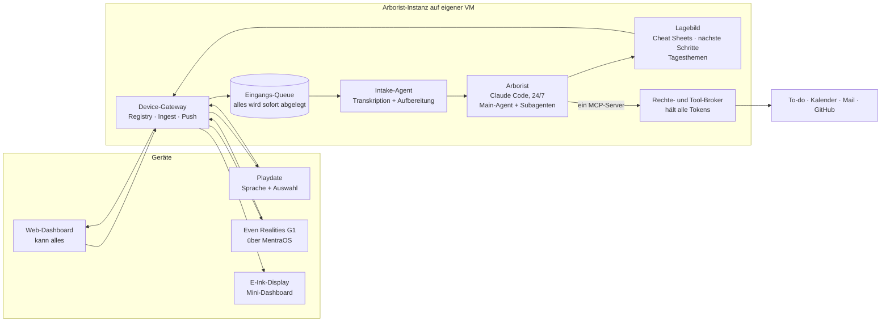

# Arborist

**Ein persönlicher Always-on-Agent, mit dem man von überall reden kann – auch von sehr einfachen Geräten aus.**

Arborist ist Claude Code, das rund um die Uhr auf einer eigenen VM läuft und Ordnung in den Alltag bringt: Ideen abladen, To-dos nachführen, an Termine und Notizen erinnern, Mails und Kalender pflegen, zusammenfassen, was gerade läuft, und kleine private Code-Projekte auf GitHub voranbringen.

Bedient wird er auf zwei Arten:

- **Web-Dashboard:** Kann alles. Lagebild, Projekte, Verlauf, Terminal.
- **Eingeschränkte Geräte:** Playdate, Smart Glasses wie die Even Realities G1, ein kleines E-Ink-Display. Man spricht hinein oder wählt aus vorbereiteten nächsten Schritten – ganz ohne Tastatur.

> Das Repo heißt noch `playdate-claude-client`, weil der Playdate der erste Client ist. Gebaut wird aber das ganze System.

## So funktioniert es



1. **Ablegen geht immer.** Jede Eingabe landet zuerst in einer Queue und wird sofort quittiert – auch wenn der Agent gerade beschäftigt ist oder die Quota leer ist.
2. **Abarbeiten asynchron.** Der Arborist holt sich Einträge in Batches, ordnet sie Projekten zu und verteilt sie an Subagenten (To-dos, Kalender und Mail, Notizen, Code).
3. **Antworten passen aufs Gerät.** Der Agent beschreibt Ergebnisse geräteunabhängig. Adapter machen daraus eine HTML-Seite, eine 1-Bit-Karte für den Playdate, ein paar Zeilen für die Brille oder ein Bild für das E-Ink-Display.
4. **Bedienbar ohne Sprache.** Ein Lagebild-Subagent liefert zu allem eine Kurzfassung und auswählbare nächste Schritte.
5. **Werkzeuge nur über den Broker.** Der Agent hat keine eigenen Zugänge. Ein Rechte- und Tool-Broker hält die Tokens, gibt dem Agenten genau einen MCP-Server und entscheidet pro Tool: erlaubt, verboten oder nur nach Bestätigung.
6. **Ein Concierge, mehrere Rollen.** Man spricht nur mit dem Concierge. Er verteilt Aufträge über Inboxen an Rollen-Agenten mit eigenem Fachgebiet, etwa Wissen oder Code, die jeweils in ihrer eigenen Sitzung laufen ([`docs/rollen.md`](docs/rollen.md)).
7. **Nachts Wartung.** Der Agent geht den Tag durch, fasst zusammen, pflegt sein Gedächtnis und plant den nächsten Tag.

## Prinzipien

- **Generisch und anpassbar:** Neue Geräte über Adapter, neue Tools über den Broker, neue Anwendungsfälle über Subagenten und Skills im eigenen Workspace. Der Kern bleibt gleich.
- **Dumme Geräte:** Die Logik liegt auf dem Server. Geräte nehmen auf, puffern, laden hoch und zeigen an.
- **Privat bleibt privat:** Persönliche Daten, Prompts und Tokens gehören nicht ins Repo, sondern in `server/.env`, den Broker bzw. den Workspace des Agenten.
- **Im Rahmen des Abos:** Claude Code läuft mit dem eigenen Claude-Abo. Ist die Quota aufgebraucht, wartet der Agent bis zum Reset – Eingaben werden weiter angenommen.
- **Für private Zwecke:** To-dos, Notizen, kleine Projekte. Keine dienstlichen Daten.

## Geräte

| Gerät | Status | Eingabe | Ausgabe |
| --- | --- | --- | --- |
| Web-Kartensimulator | als Nächstes (Meilenstein 2) | Sprache, Auswahl | 1-Bit-Karten in Playdate-Größe |
| Web-Dashboard | geplant (Meilenstein 4) | Sprache, Text, Terminal | alles |
| Playdate | POC in Arbeit | Sprache (auch offline gepuffert), Kurbel, Tasten | 1-Bit-Karten |
| E-Ink-Display | geplant | – | Mini-Dashboard |
| Even Realities G1 | geplant, über [MentraOS](https://github.com/Mentra-Community/MentraOS) | Sprache, Tasten | kurze Textansichten |

Der Playdate kann nur bei geöffneter App senden und empfangen; Aufnahmen werden bis dahin gepuffert.

## Meilensteine

1. **Bootstrap in der Cloud:** Claude Code läuft dauerhaft auf einem eigenen Server (Standard Hetzner Cloud, eingerichtet per GitHub-Workflow) und wird per Remote Control vom Handy bedient, auch per Diktat. Ab hier baut der Agent den Rest selbst mit. Anleitung: [`docs/bootstrap.md`](docs/bootstrap.md).
2. **Web-Kartensimulator:** Eine Webseite mit einem Display in Playdate-Größe (400×240, 1 Bit). Sprache aufnehmen, hochladen, und der Concierge antwortet mit Karten passend zum Thema – etwa eine Tageskarte mit To-dos zum Abhaken oder eine Tagesübersicht mit Terminen. Daran wird iteriert, bevor echte Hardware dazukommt.
3. **Playdate-POC:** Dieselben Karten auf dem echten Gerät, mit Offline-Puffer.
4. **Web-Dashboard:** Lagebild, Terminal, Nachtwartung.
5. **Queue, Gateway und Lagebild:** Asynchroner Eingang, generische Ansichten, nächste Schritte.
6. **Broker:** To-dos, Kalender, Mail, GitHub – nur über den Broker.
7. **Weitere Geräte:** E-Ink-Display, Even Realities G1.

## Zum Diskutieren

Fragen, bei denen Gegenwind willkommen ist:

- Ist die Trennung in Intake-Agent, Main-Agent und Lagebild-Subagent sinnvoll, oder zu viel?
- Broker selbst bauen oder ein bestehendes MCP-Gateway nutzen?
- Reicht SQLite als Queue, oder lohnt sich früh NATS bzw. Redis Streams?
- Wie sicher ist ein Agent mit Shell-Zugriff, wenn nur die externen Tools über den Broker laufen?
- Trägt das Abo-Modell auf Dauer, oder muss die Agent-Anbindung austauschbar werden?

## Doku

| Datei | Inhalt |
| --- | --- |
| [`docs/bootstrap.md`](docs/bootstrap.md) | Meilenstein 1: Agent in der Cloud zum Laufen bringen |
| [`docs/rollen.md`](docs/rollen.md) | Concierge, Rollen-Agenten und Inboxen |
| [`docs/arc42.md`](docs/arc42.md) | Architektur nach arc42 mit C4-Diagrammen |
| [`docs/vision.md`](docs/vision.md) | Vision, Bausteine, Betriebsmodi und Quota |
| [`docs/karten-dsl.md`](docs/karten-dsl.md) | Format der Karten für den Playdate |
| [`docs/poc-setup.md`](docs/poc-setup.md) | POC auf dem lokalen Rechner aufsetzen |
| [`docs/devlog/`](docs/devlog/README.md) | Entwicklertagebuch, ein Eintrag pro Arbeitstag |

## Struktur

| Pfad | Inhalt |
| --- | --- |
| `infra/` | Server per Pulumi anlegen (Standard Hetzner), gesteuert über GitHub-Workflow |
| `host/` | Einrichtung des Servers: Rollen-Sitzungen, Inbox-Watcher, Vorlagen |
| `server/` | Ingest-API, Transkription, Queue, Agent-Worker |
| `playdate/` | Playdate-Client (Lua) |
| `tools/fake_playdate.py` | Simuliert den Playdate vom Rechner aus |

## Schnellstart (POC lokal)

```bash
cd server
python3 -m venv .venv && . .venv/bin/activate
pip install -r requirements.txt
PDC_TOKEN=geheim PDC_AGENT=echo uvicorn main:app --host 0.0.0.0 --port 8000
```

Dann `python3 tools/fake_playdate.py --text "Hallo"` – Details in [`docs/poc-setup.md`](docs/poc-setup.md).
