# Architektur von Arborist nach arc42

> Gesamtarchitektur. Erster Meilenstein ist der Bootstrap in der Cloud ([`bootstrap.md`](bootstrap.md)), danach wird der Rest mit dem laufenden Agenten gebaut (Kapitel 12). Hintergrund und Betriebsmodi: [`vision.md`](vision.md).

## 1. Einführung und Ziele

**Arborist** ist ein persönlicher Always-on-Agent auf Basis von Claude Code. Er läuft auf einer eigenen VM und hält Ordnung in allem, was im Alltag anfällt. Bedient wird er von einem vollwertigen HTML-Dashboard und von sehr eingeschränkten Geräten: Handhelds, E-Ink-Displays, Smart Glasses.

### Anwendungsfälle

| Bereich | Beispiele |
| --- | --- |
| Ideen und Notizen | Gedanken per Sprache abladen, später geordnet wiederfinden |
| To-dos | Listen anlegen und nachführen, Erledigtes abhaken, Offenes erinnern |
| Erinnerungen und Kalender | Termine eintragen, an Fristen und Notizen erinnern |
| Mails | Zusammenfassen, Entwürfe vorbereiten, Wichtiges hervorheben |
| Lagebild | Was läuft gerade, was ist heute passiert, was steht morgen an |
| Kleine Code-Projekte | Private GitHub-Repos: Issues, kleine Änderungen, Pull Requests |

Nicht vorgesehen: dienstliche Daten, Mehrbenutzerbetrieb, Sprachausgabe.

### Qualitätsziele

| Priorität | Qualitätsziel | Messbar als |
| --- | --- | --- |
| 1 | Ablegen geht immer | Eingabe ist < 2 s nach Upload-Ende quittiert, auch wenn der Agent pausiert |
| 2 | Bedienbar ohne Sprache | Jede Ausgabe enthält auswählbare nächste Schritte |
| 3 | Kontrollierte Werkzeuge | Kein Token im Agenten; jeder Tool-Aufruf ist erlaubt, protokolliert und widerrufbar |
| 4 | Anpassbar | Neues Gerät, neues Tool oder neuer Anwendungsfall ohne Änderung am Kern |
| 5 | Offline-Robustheit der Clients | Keine Eingabe geht verloren; Upload setzt nach Abbruch fort |

### Stakeholder

| Rolle | Erwartung |
| --- | --- |
| Betreiber und Nutzer (eine Person) | Ein Assistent, der immer erreichbar ist und den eigenen Alltag kennt |
| Andere, die das Repo nutzen | Generischer Stack, den sie auf eigene Geräte und Anwendungsfälle zuschneiden |

## 2. Randbedingungen

- **Agent:** Claude Code CLI, angemeldet mit dem Claude-Abo des Nutzers über den offiziellen Login. Gearbeitet wird innerhalb der Abo-Quota (Fünf-Stunden-Fenster, Wochenlimit).
- **Betrieb:** Azure-VM mit Docker, provisioniert mit Pulumi. Lokaler Betrieb für Entwicklung und POC.
- **Playdate:** 400×240 Pixel, 1 Bit, WLAN 2,4 GHz, Mikrofon, Lua- und C-API (SDK 2.x). Netzwerk nur bei geöffneter App, kein Push.
- **Even Realities G1:** Monochromes Display in der Brille, Anbindung über das Handy. Apps laufen über MentraOS als Miniapp in der Mentra-App auf dem Handy.
- **Generisch:** Keine persönlichen Daten, Prompts, Hostnamen oder Tokens im Repo. Konfiguration über Umgebungsvariablen und einen privaten Agent-Workspace.

## 3. Kontextabgrenzung

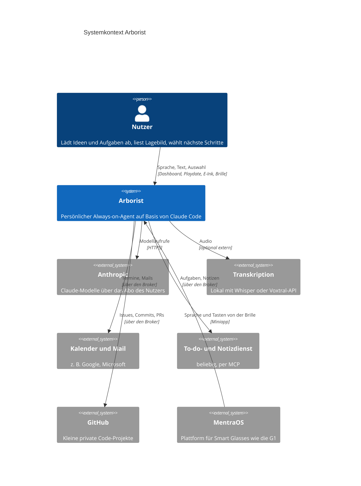

| Nachbar | Richtung | Inhalt |
| --- | --- | --- |
| Geräte | ↔ | Eingaben (Audio, Text, Auswahl) hin, Ansichten zurück |
| Anthropic | ↔ | Prompts und Antworten von Claude Code |
| Transkription | ↔ | Audio hin, Text zurück; lokal oder Voxtral |
| Kalender, Mail, To-do, GitHub | ↔ | Nur über den Rechte- und Tool-Broker |
| MentraOS | → | Miniapp auf dem Handy leitet Brillen-Eingaben weiter und zeigt Ansichten an |

## 4. Lösungsstrategie

| Ziel | Ansatz |
| --- | --- |
| Ablegen geht immer | Eingangs-Queue vor allem anderen. Quittung, sobald gespeichert. Agent arbeitet asynchron in Batches. |
| Bedienbar ohne Sprache | Lagebild-Subagent erzeugt zu allem Cheat Sheets, nächste Schritte und Tagesthemen. |
| Viele, sehr unterschiedliche Geräte | Agent erzeugt eine **generische Ansicht**. Ausgabe-Adapter rendern sie pro Gerät. Geräte sind dumm. |
| Kontrollierte Werkzeuge | Rechte- und Tool-Broker als einziger MCP-Server des Agenten. Tokens nur dort. |
| Anpassbar | Erweiterungspunkte statt fester Logik: Geräte-Adapter, Broker-Tools, Subagenten und Skills im privaten Workspace. |
| Im Rahmen der Quota | Ereignisgesteuert, Leerlauf ohne Modellaufrufe, Nachtwartung mit festem Budget. |

## 5. Bausteinsicht

### Ebene 2: Container

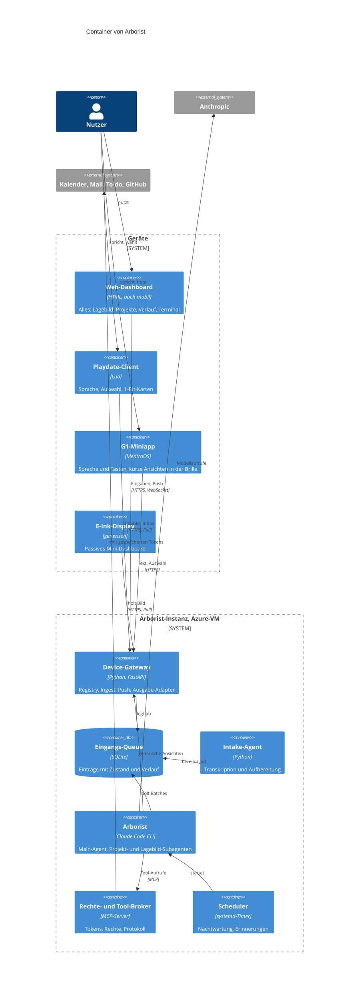

| Container | Verantwortung |
| --- | --- |
| Device-Gateway | Einziger Eingang. Geräte-Registry mit Token und Fähigkeiten, Ingest (chunked, idempotent), Push bzw. Pull, Ausgabe-Adapter |
| Eingangs-Queue | Speichert jede Eingabe dauerhaft, bevor ein Modell beteiligt ist. Zustände und Verlauf |
| Intake-Agent | Transkribiert, bereinigt, erkennt Bezug und Dringlichkeit. Kein Tool-Zugriff außer der Queue |
| Arborist | Claude Code mit fortgesetzter Session. Holt Batches, ordnet Projekten zu, delegiert an Subagenten |
| Rechte- und Tool-Broker | Hält alle externen Tokens, stellt dem Agenten genau einen MCP-Server mit den erlaubten Tools bereit |
| Scheduler | Startet Nachtwartung und zeitgesteuerte Erinnerungen außerhalb des Agenten |

### Ebene 3: Arborist intern

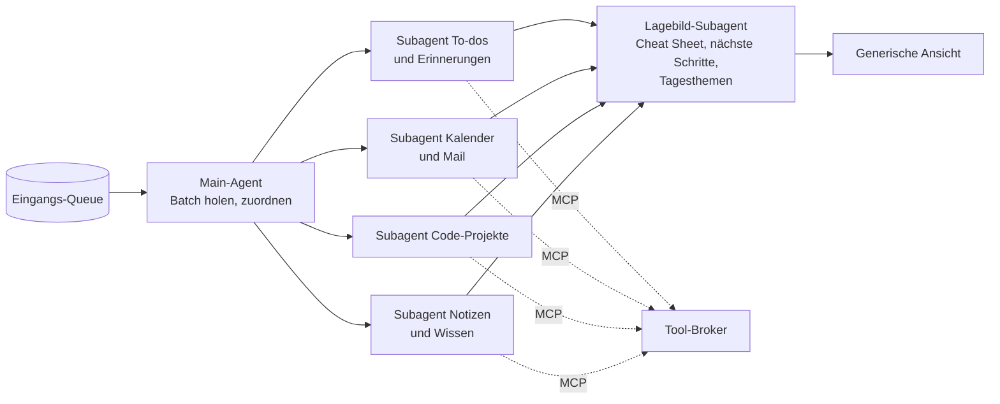

Welche Subagenten es gibt, ist Konfiguration im privaten Agent-Workspace, nicht Teil des Repos. Die vier oben sind die Vorlage für den persönlichen Einsatz.

### Ebene 3: Device-Gateway intern

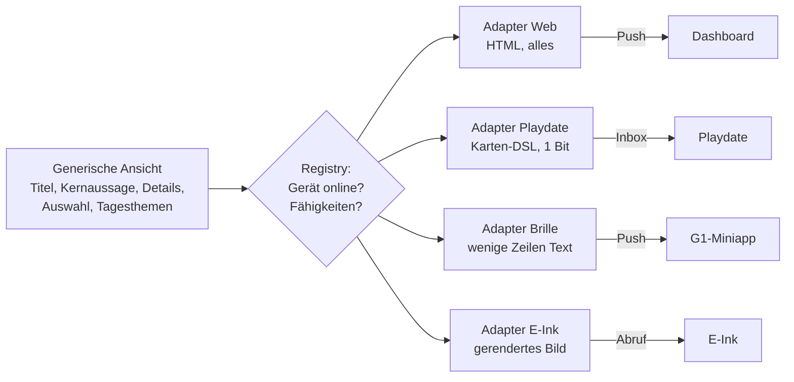

### Zustände eines Queue-Eintrags

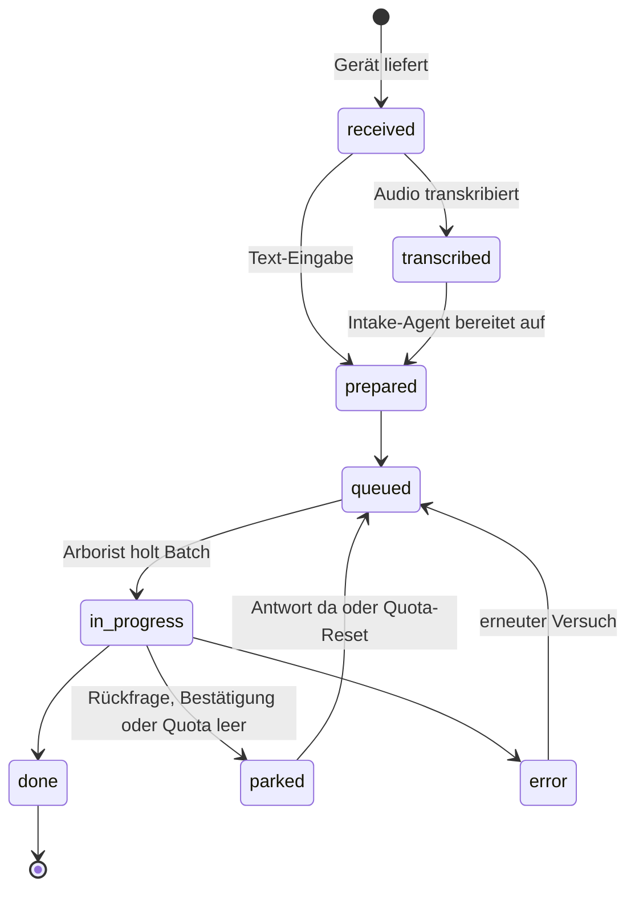

### POC-Bausteine

#### Playdate-Client

| Baustein | Aufgabe |
| --- | --- |
| Recorder | Mikrofon → Sample → WAV; Downsampling auf ca. 8,8 kHz / 8 Bit |
| Outbox | Offene Aufnahmen und Interaktionen; Chunking, Retry mit Backoff, Fortschritt |
| Inbox | Polling `/inbox?since=`, lokaler Karten-Cache für Offline-Ansicht |
| Renderer | Interpretiert die Karten-DSL |
| Asset-Cache | Tilesets und Bitmaps nach Hash |
| Input | A = sprechen/auswählen, Kurbel = scrollen, Steuerkreuz = Auswahl |

#### Server

| Baustein | Aufgabe |
| --- | --- |
| Ingest-API | `PUT /rec/{id}/chunk/{n}`, `GET /rec/{id}`, `POST /rec/{id}/done` |
| Transkription | Provider wählbar: faster-whisper/whisper.cpp lokal (Standard) oder Voxtral-API, Sprache `de` |
| Queue | SQLite-Tabelle `jobs` mit den Zuständen oben |
| Agent-Worker | Ein Thread, arbeitet Jobs nacheinander ab, hält die Session-ID |
| Card-Service | Validiert Karten, Fallback auf Textkarte, schreibt in die Inbox |
| Asset-Service | `GET /assets/{hash}` |
| Interaction-API | `POST /interaction` → neuer Job in derselben Agent-Session |

## 6. Laufzeitsicht

### Szenario A: Sprechen ohne Netz (Playdate)

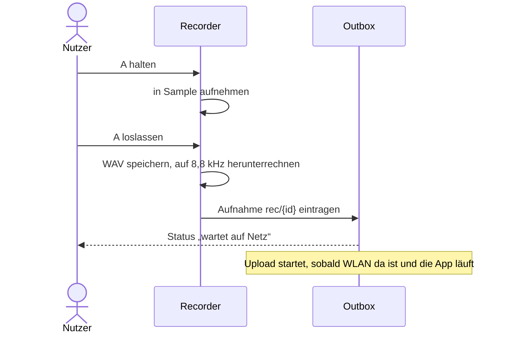

### Szenario B: Upload und Ausführung

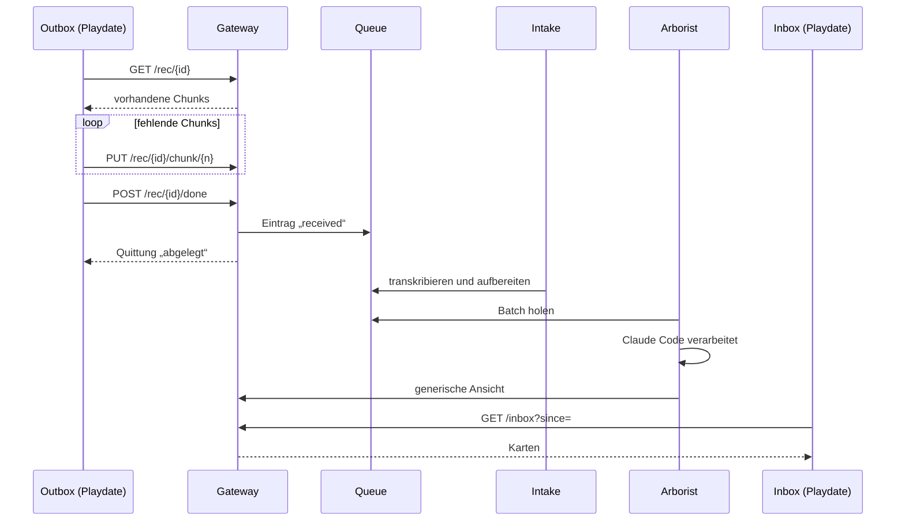

### Szenario C: Bedienen ohne Sprache

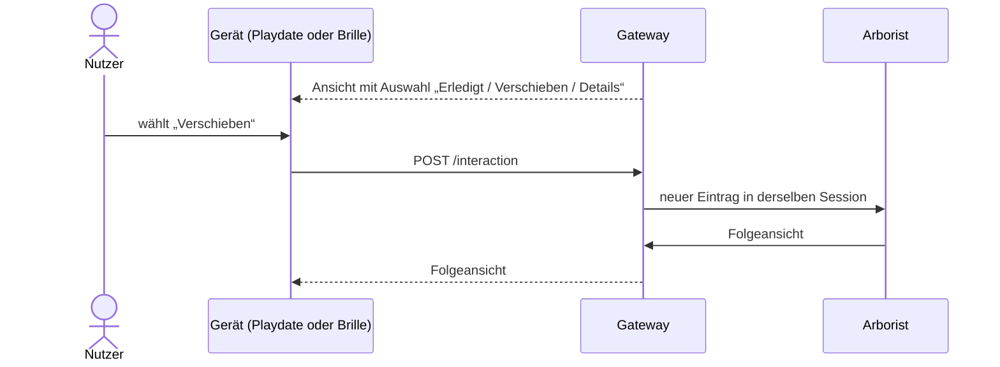

### Szenario D: Asynchrone Abarbeitung und leere Quota

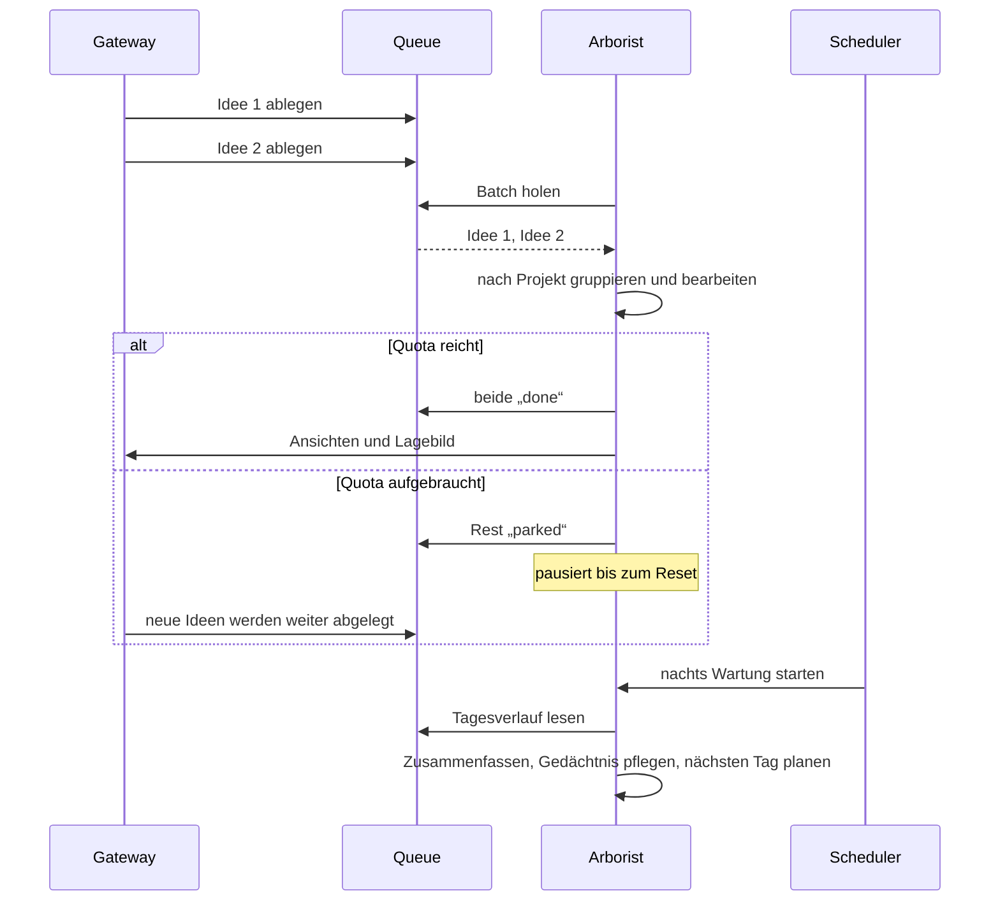

### Szenario E: Tool-Aufruf mit Bestätigung

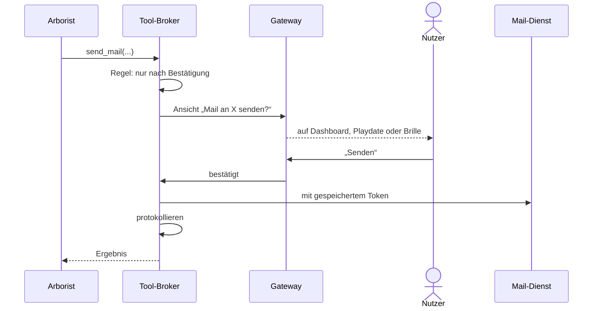

## 7. Verteilungssicht

| Variante | Läuft auf | Erreichbarkeit | Zweck |
| --- | --- | --- | --- |
| Bootstrap | Azure-VM, nur Claude Code mit Remote Control | Nur ausgehend; SSH für Admin | Agent sofort nutzbar, baut den Rest |
| POC | Lokaler Rechner oder die VM | LAN bzw. HTTPS mit Token | Playdate-Ablauf und Latenz testen |
| V2 | Azure-VM (z. B. B2s, 2 vCPU, 4 GB RAM), Docker, Pulumi | HTTPS über Reverse Proxy, nur Port 443 | Dauerbetrieb |

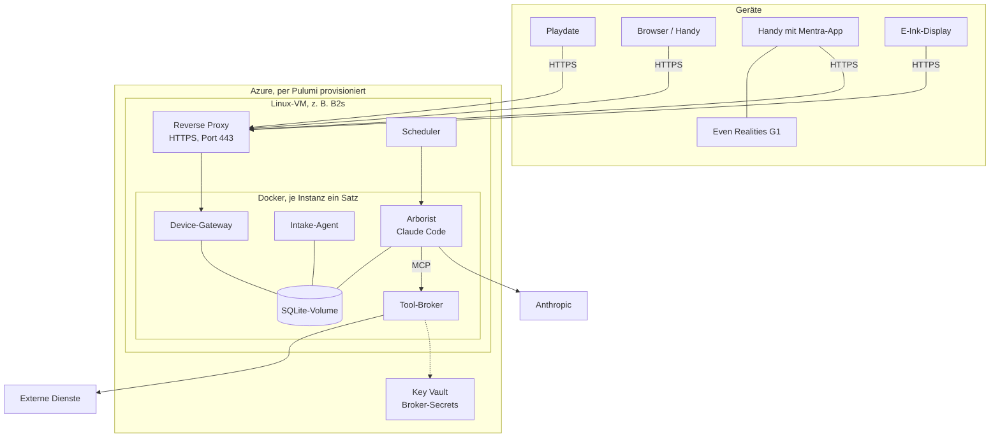

Netzwerk: Der Arborist-Container darf nur zum Broker und zu Anthropic. Nur der Reverse Proxy ist von außen erreichbar. Für den POC reicht ein Prozess.

## 8. Querschnittliche Konzepte

### Generische Ansicht

Der Agent beschreibt Ausgaben geräteunabhängig: Titel, eine Kernaussage, optionale Details, auswählbare nächste Schritte, Tagesthemen. Jedes Gerät meldet bei der Registrierung seine Fähigkeiten (Eingabe: Sprache, Text, Auswahl; Ausgabe: HTML, 1-Bit-Karte, Kurztext, Bild). Der passende Adapter kürzt und rendert. Der Playdate nutzt dafür die [Karten-DSL](karten-dsl.md).

### Anpassbarkeit

| Erweiterungspunkt | Wo | Beispiel |
| --- | --- | --- |
| Neues Gerät | Ausgabe-Adapter im Gateway, Eintrag in der Registry | E-Ink-Display, andere Brille |
| Neues Tool | Im Broker anmelden, Regel setzen | Kalender, To-do-Dienst |
| Neuer Anwendungsfall | Subagent oder Skill im privaten Agent-Workspace | Haushaltsbuch, Lernplan |
| Andere Transkription | Provider-Konfiguration | Whisper lokal, Voxtral |
| Weitere Instanz | Pulumi-Stack mit eigenen Parametern | getrennte Instanzen |

### Rollen und Sitzungen

Der Agent läuft als mehrere Rollen in getrennten Claude-Code-Sitzungen: ein **Concierge** als einziger Gesprächspartner und dahinter Rollen-Agenten mit eigenem Arbeitsverzeichnis, eigenen Skills und eigener Inbox. Rollen kommunizieren nur über Inboxen. systemd und tmux halten die Sitzungen am Laufen und setzen sie nach einem Neustart fort. Details: [`rollen.md`](rollen.md).

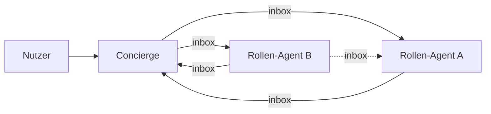

### Gedächtnis

Der Agent hält sein Wissen in Dateien im Workspace (Projekte, Vorlieben, offene Punkte). Die Nachtwartung fasst den Tag zusammen und räumt auf. Persönliche Inhalte liegen nie im Repo.

### Audioformat (Playdate)

- Aufnahme: 44,1 kHz, 8 Bit mono im Playdate-Sample.
- Upload: jedes 5. Sample, also ca. 8,8 kHz, 8 Bit unsigned, roh (ca. 8,8 KB/s).
- Chunkgröße: 8 KB.
- Server: wandelt zu 16-Bit-WAV, Whisper rechnet auf 16 kHz um.
- Später optional: Tiefpass vor dem Downsampling und IMA-ADPCM in C.

### Agent-Anweisung

Der System-Prompt liegt nicht im Repo, sondern in einer Datei, auf die `PDC_AGENT_PROMPT` zeigt. Eine Beispielanweisung liegt in `server/agent_prompt.example.md`.

### Sicherheit

- Gerätetoken im Header `X-Token`, pro Gerät widerrufbar.
- POC nur im LAN. V2 nur über HTTPS, Port 443, Rate-Limit am Reverse Proxy.
- Externe Tokens nur im Broker (Key Vault). Der Agent-Container enthält keine Zugangsdaten.
- Eingebaute Werkzeuge von Claude Code (Shell, Dateien) laufen nicht über den Broker; sie werden über `settings.json` und Netzwerkregeln eingeschränkt.
- Instanzen strikt trennen. Keine dienstlichen Daten in einer privaten Instanz.

## 9. Architekturentscheidungen

| ADR | Entscheidung | Begründung |
| --- | --- | --- |
| 1 | Transkription lokal mit Whisper als Standard | Datenschutz |
| 2 | Chunked Upload statt Streaming | Playdate-Netz unzuverlässig, Wiederaufnahme nötig |
| 3 | Polling für Geräte ohne Push-Kanal | Playdate und E-Ink können keinen Push; Web und Brille bekommen Push |
| 4 | Deklarative Karten-DSL | Neue Darstellungen ohne Client-Update |
| 5 | Zuerst Bootstrap in der Cloud mit Remote Control (ersetzt „erst lokaler POC“) | Der laufende Agent baut den Rest selbst; Remote Control braucht keine eingehenden Ports |
| 6 | Downsampling in Lua im POC | Schnell umsetzbar; C nur, wenn zu langsam |
| 7 | Transkription als austauschbarer Provider | Voxtral ist günstig und gut; lokal bleibt Standard |
| 8 | Azure-VM mit Docker, IaC mit Pulumi | Dauerhafte Shell für Claude Code; reproduzierbar |
| 9 | Externe Tools nur über einen Rechte- und Tool-Broker | Tokens außerhalb des Agenten; granulare Rechte und Protokoll |
| 10 | Eingangs-Queue vor dem Agenten, asynchrone Batches | Ablegen geht immer; Quota wird geschont |
| 11 | Generische Ansicht plus Geräte-Adapter | Sehr unterschiedliche Geräte ohne Logik im Client |
| 12 | Claude Code mit Abo, keine Überlauf-Abrechnung | Kosten planbar; Quota leer heißt warten bis zum Reset |
| 13 | Remote Control bleibt als Admin-Zugang | Funktioniert unabhängig vom eigenen Gateway; Notfallzugang, wenn eigene Teile kaputt sind |
| 14 | Rollen als getrennte Sitzungen mit Inbox statt Rollenwechsel in einer Sitzung | Saubere Trennung von Kontext, Skills und Regeln; Rollen bleiben einzeln ansprechbar |
| 15 | Concierge als einziger Gesprächspartner | Eine Stelle für Sprache, Ordnen und Verteilen; entspricht dem Intake-Agenten |
| 16 | Wiederanlauf über systemd, Sitzungen mit `--continue` | Alle Rollen kommen nach einem Neustart zurück; Herdr nur als optionale Admin-Ansicht |

## 10. Qualitätsszenarien

- Agent pausiert wegen leerer Quota, Nutzer spricht eine Idee ein: Quittung „abgelegt“ in < 2 s, Bearbeitung nach dem Reset.
- Nutzer hat nur die Brille: Er kann die Tagesthemen durchgehen und einen nächsten Schritt wählen, ohne zu sprechen.
- Neues E-Ink-Display: Anbindung mit einem neuen Adapter, ohne Änderung an Agent oder Queue.
- Agent will eine Mail senden: Ohne Bestätigung passiert nichts; der Aufruf steht im Protokoll.
- WLAN reißt bei Chunk 5 von 10 ab: Upload setzt bei Chunk 6 fort, keine Duplikate.
- Agent liefert kaputtes JSON: Nutzer sieht eine lesbare Textansicht.
- Server neu gestartet: Queue und Verlauf bleiben erhalten, offene Einträge werden fortgesetzt.

## 11. Risiken und technische Schulden

| Risiko | Auswirkung | Gegenmaßnahme |
| --- | --- | --- |
| Abo-Bedingungen ändern sich | Headless-Betrieb wird anders abgerechnet | Bedingungen beobachten; Agent-Anbindung austauschbar halten |
| Quota reicht nicht | Lange Wartezeiten | Batches, Leerlauf, Wartung mit Budget |
| Agent mit Shell-Zugriff | Schaden im Container | Keine Tokens im Container, Netzwerkregeln, `settings.json` |
| MentraOS-SDK ist Beta | Brillen-Anbindung bricht | Miniapp dünn halten, nur Text und Auswahl |
| Downsampling in Lua zu langsam | Hänger nach der Aufnahme | Schrittweise pro Frame oder in C |
| HTTP-Body-Limits auf dem Playdate | Upload scheitert | Kleine Chunks, Größe empirisch ermitteln |
| Netzwerk nur bei offener App | Kein Hintergrund-Upload | Outbox beim App-Start, Hinweis in der UI |

## 12. Meilensteine

1. **Bootstrap in der Cloud** ([`bootstrap.md`](bootstrap.md))
   - [ ] Azure-VM per Pulumi, nur SSH eingehend
   - [ ] Claude Code installiert und mit dem Abo angemeldet
   - [ ] Privater Workspace mit eigener `CLAUDE.md`, Repo geklont
   - [ ] `claude remote-control` läuft dauerhaft (tmux, dann systemd)
   - [ ] Bedienung vom Handy inklusive Diktat; Trusted Devices an
   - [ ] Erste echte Aufgabe: Der Agent baut am eigenen Repo weiter
2. **POC Playdate** (Server läuft schon auf der VM)
   - [ ] Server lokal: Chunk-Ingest, Whisper, Queue, Echo- und Claude-Agent
   - [ ] `tools/fake_playdate.py` für Tests ohne Hardware
   - [ ] Playdate: Aufnahme mit A, Downsampling, Outbox mit Chunks und Retry
   - [ ] Inbox-Polling und Renderer für `text`, `list`, `icon`, `bar`, `choices`
   - [ ] Messung: Zeit vom Loslassen bis zur ersten Karte
3. **Web-Dashboard:** Lagebild und Terminal, Nachtwartung über den Scheduler.
4. **Queue, Gateway und Lagebild:** Asynchroner Eingang, Registry, generische Ansicht, Lagebild-Subagent.
5. **Broker:** To-dos, Kalender, Mail und GitHub nur über den Broker, Bestätigungen per Ansicht.
6. **Weitere Geräte:** E-Ink-Mini-Dashboard, Even Realities G1 über MentraOS.

## 13. Offene Fragen

- Queue-Technik: SQLite zum Start, später NATS JetStream oder Redis Streams?
- Broker selbst bauen oder auf ein bestehendes MCP-Gateway aufsetzen?
- Kann die MentraOS-Miniapp direkt mit dem Gateway sprechen, und nutzt sie besser die Transkription von MentraOS oder schickt sie Audio?
- Welches E-Ink-Display wird die Referenz?
