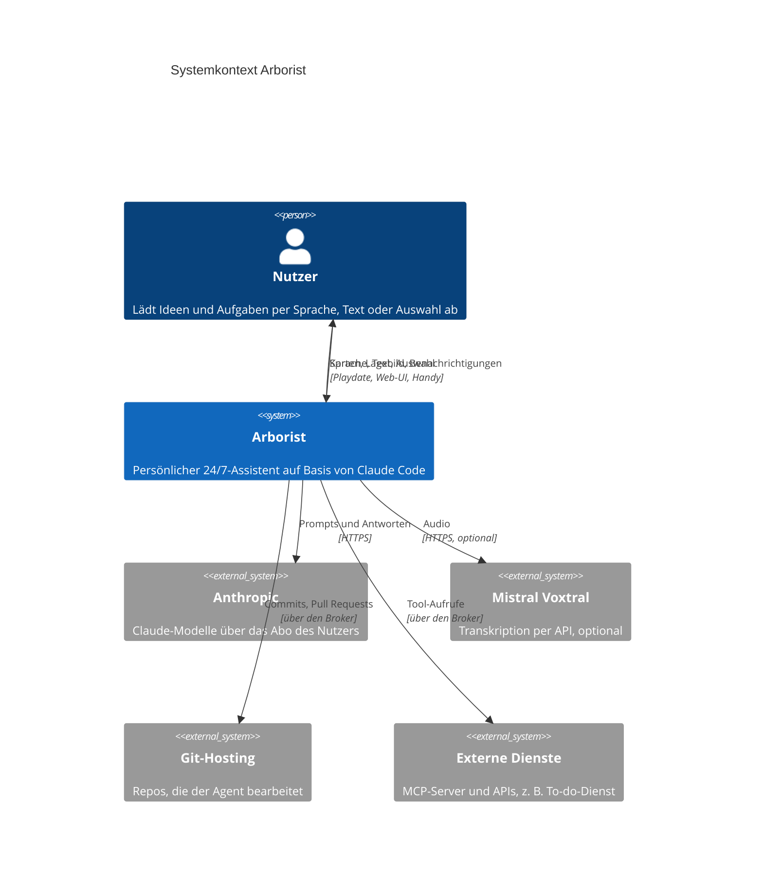
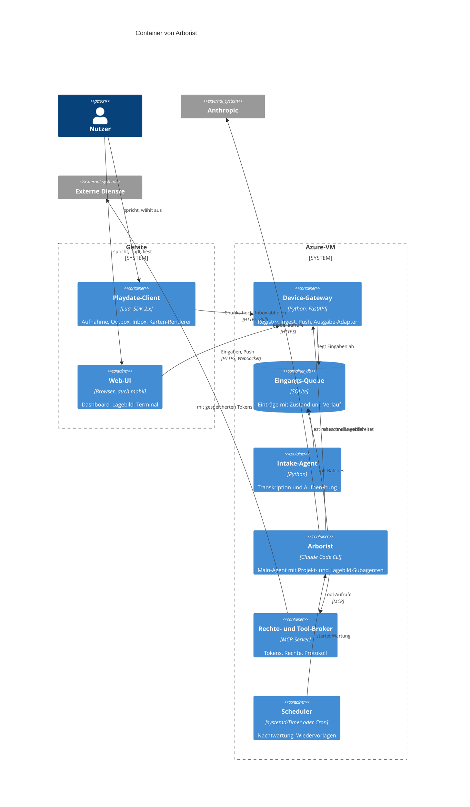
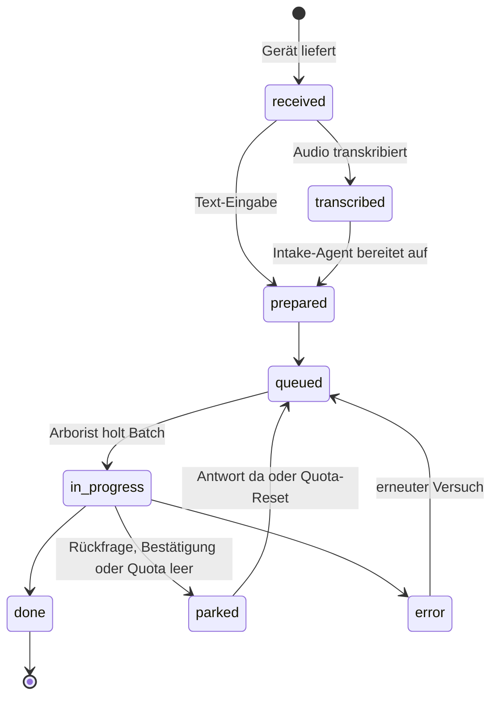
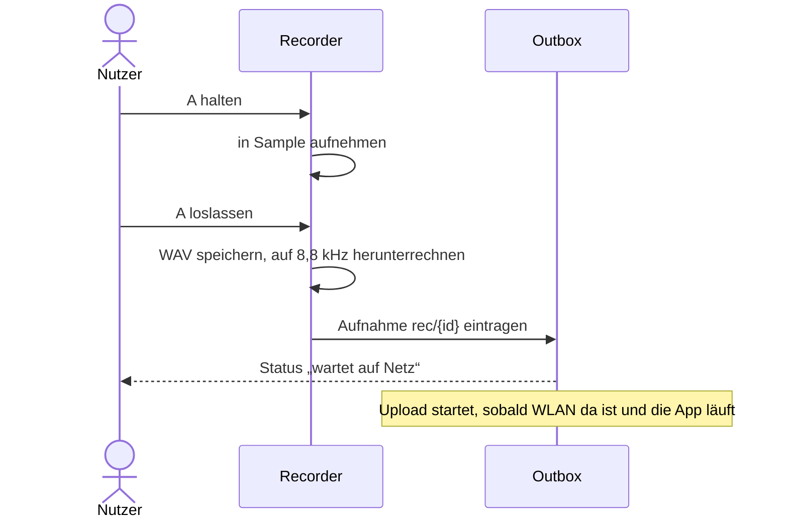
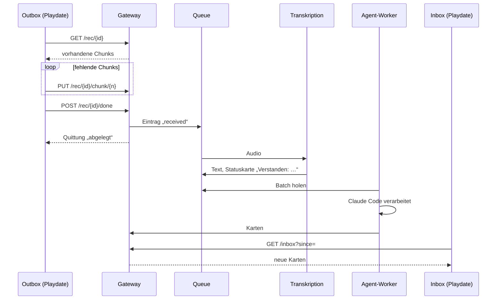
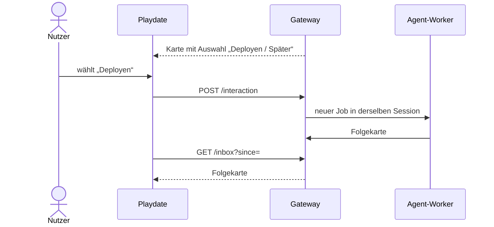
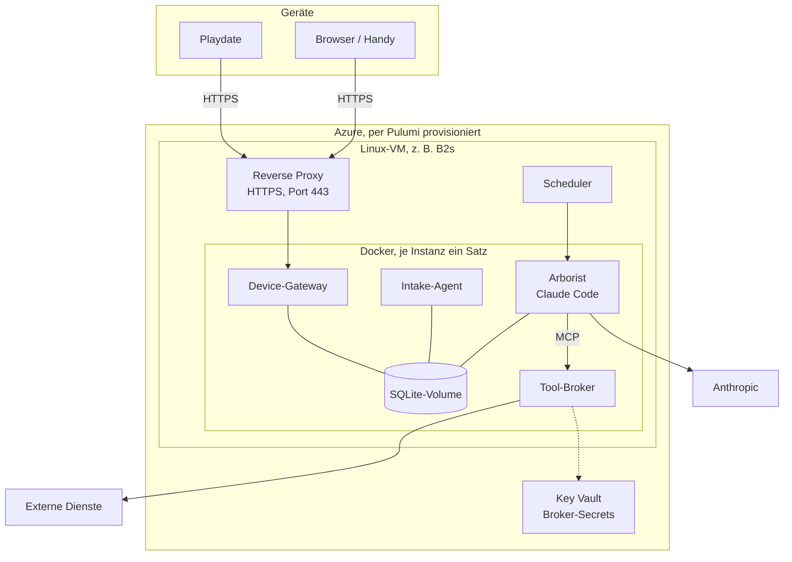

# Architektur nach arc42

> Dieses Dokument beschreibt den Playdate-POC. Vision und Gesamtscope von Arborist (Main-Agent, Subagenten, Device-Gateway, Rechte- und Tool-Broker) stehen in [`vision.md`](vision.md).

## 1. Einführung und Ziele

Ein dauerhaft erreichbarer persönlicher Assistent auf Basis von Claude Code, bedient per Sprache vom Playdate. Der Playdate funktioniert auch offline: Aufnahmen werden gepuffert und bei Verbindung häppchenweise hochgeladen. Ergebnisse kommen als dynamische 1-Bit-Karten mit Animation und Interaktion zurück.

| Priorität | Qualitätsziel | Messbar als |
| --- | --- | --- |
| 1 | Flüssiger Ablauf | Aufnahme startet < 200 ms nach A; Statuskarte „verstanden“ < 10 s nach Upload-Ende |
| 2 | Offline-Robustheit | Keine Aufnahme geht verloren; Upload setzt nach Abbruch fort |
| 3 | Datenschutz | Transkriptions-Provider ist pro Instanz wählbar; Standard ist lokal |
| 4 | Erweiterbare Darstellung | Neue Kartentypen ohne Client-Update |

Stakeholder: Betreiber des eigenen Servers, der zugleich einziger Nutzer ist.

## 2. Randbedingungen

- Playdate: 400×240 Pixel, 1 Bit, WLAN 2,4 GHz, Mikrofon mit 44,1 kHz, Lua- und C-API (SDK 2.x).
- Netzwerk nur bei geöffneter App; der Nutzer muss den Serverzugriff einmal erlauben.
- Keine eingebaute Audiokompression. Downsampling wird selbst implementiert.
- Claude Code im Headless-Modus (`claude -p`) oder über das Agent SDK.
- POC auf lokalem Rechner im LAN, Variante 2 auf einer Linux-VM mit HTTPS.

## 3. Kontextabgrenzung

Systemkontext von Arborist (C4, Ebene 1):

Für den POC relevant:

| Nachbar | Richtung | Inhalt |
| --- | --- | --- |
| Playdate | → Server | Audio-Chunks, Interaktionen (Auswahl) |
| Playdate | ← Server | Karten, Tilesets, Bitmaps |
| Anthropic | ↔ | Prompts und Antworten von Claude Code |
| Git-Hosting (z. B. GitHub) | ↔ | Repos, die der Agent bearbeitet |
| Optional: Webhosting | ← | Kleine Seiten, die der Agent veröffentlicht |

## 4. Lösungsstrategie

- **Thin Client:** Der Playdate nimmt auf, puffert, lädt hoch und rendert. Sonst nichts.
- **Store-and-forward:** Jede Aufnahme bekommt eine ID und wird in nummerierten Chunks übertragen – idempotent und wiederaufnehmbar.
- **Asynchron über eine Queue:** Upload, Transkription und Agent laufen entkoppelt.
- **Persistenter Agent:** Ein Worker führt eine fortgesetzte Claude-Code-Session (`--resume`), damit der Agent Kontext über Aufträge hinweg behält.
- **Deklarative Karten-DSL:** Der Agent beschreibt Karten als JSON-Szenen, der Client hat einen generischen Renderer.
- **Pull statt Push:** Der Playdate fragt bei geöffneter App die Inbox mit einem `since`-Cursor ab.

## 5. Bausteinsicht

### Zielbild Arborist (C4, Ebene 2)

### Zustände eines Queue-Eintrags

### POC-Bausteine

#### Playdate-Client

| Baustein | Aufgabe |
| --- | --- |
| Recorder | Mikrofon → Sample → WAV; Downsampling auf ca. 8,8 kHz / 8 Bit |
| Outbox | Offene Aufnahmen und Interaktionen; Chunking, Retry mit Backoff, Fortschritt |
| Inbox | Polling `/inbox?since=`, lokaler Karten-Cache für Offline-Ansicht |
| Renderer | Interpretiert die Karten-DSL |
| Asset-Cache | Tilesets und Bitmaps nach Hash |
| Input | A = sprechen/auswählen, Kurbel = scrollen, Steuerkreuz = Auswahl |

#### Server

| Baustein | Aufgabe |
| --- | --- |
| Ingest-API | `PUT /rec/{id}/chunk/{n}`, `GET /rec/{id}`, `POST /rec/{id}/done` |
| Transkription | Provider wählbar: faster-whisper/whisper.cpp lokal (Standard) oder Voxtral-API, Sprache `de` |
| Queue | SQLite-Tabelle `jobs` mit Zuständen `uploading → transcribing → queued → running → done/error` |
| Agent-Worker | Ein Thread, arbeitet Jobs nacheinander ab, hält die Session-ID |
| Card-Service | Validiert Karten, Fallback auf Textkarte, schreibt in die Inbox |
| Asset-Service | `GET /assets/{hash}` |
| Interaction-API | `POST /interaction` → neuer Job in derselben Agent-Session |

## 6. Laufzeitsicht

### Szenario A: Sprechen ohne Netz

1. A halten: Recorder nimmt in ein Sample auf.
2. A loslassen: Sample wird als WAV gespeichert, heruntergerechnet und als `rec/<id>.raw` abgelegt. Eintrag in der Outbox, Status „wartet auf Netz“.
3. Sobald WLAN da ist und die App läuft, beginnt die Outbox mit dem Upload.

### Szenario B: Upload und Ausführung

1. Outbox fragt `GET /rec/{id}` und erfährt, welche Chunks der Server schon hat.
2. Fehlende Chunks werden per `PUT` gesendet.
3. `POST /rec/{id}/done` mit Samplerate. Server baut eine WAV-Datei, transkribiert und legt eine Statuskarte „Verstanden: …“ in die Inbox.
4. Der Agent-Worker übernimmt den Job und erzeugt eine oder mehrere Karten.
5. Der Playdate pollt die Inbox, lädt fehlende Assets und rendert.

### Szenario C: Interaktion

1. Karte bietet Auswahl, z. B. „Deployen / Später“.
2. Auswahl wird über die Outbox an `/interaction` gesendet.
3. Der Server legt einen Job an, der Agent antwortet in derselben Session mit einer neuen Karte.

### Szenario D: Asynchrone Abarbeitung und leere Quota

## 7. Verteilungssicht

| Variante | Server läuft auf | Erreichbarkeit | Zweck |
| --- | --- | --- | --- |
| POC | Lokaler Rechner (Linux, macOS, WSL2) | LAN, HTTP mit Token | Ablauf und Latenz testen |
| V2 | Azure-VM (z. B. B2s, 2 vCPU, 4 GB RAM), per Pulumi provisioniert, Docker | HTTPS über Reverse Proxy, nur Port 443 | Dauerbetrieb |

In V2 läuft der Server als Docker-Container, je Instanz ein eigener Satz.

Netzwerk: Der Arborist-Container darf nur zum Broker und zu Anthropic. Nur der Reverse Proxy ist von außen erreichbar. Für den POC reicht ein Prozess.

## 8. Querschnittliche Konzepte

### Audioformat

- Aufnahme: 44,1 kHz, 8 Bit mono im Playdate-Sample.
- Upload: jedes 5. Sample, also ca. 8,8 kHz, 8 Bit unsigned, roh (ca. 8,8 KB/s).
- Chunkgröße: 8 KB.
- Server: wandelt zu 16-Bit-WAV, Whisper rechnet auf 16 kHz um.
- Später optional: Tiefpass vor dem Downsampling und IMA-ADPCM in C (halbiert die Datenmenge).

### Karten

Siehe [`karten-dsl.md`](karten-dsl.md). Kernregeln: eine Kernaussage pro Karte, maximal sechs Zeilen à 40 Zeichen, Details als Folgekarten.

### Agent-Anweisung

Der System-Prompt des Agenten liegt nicht im Repo, sondern in einer Datei, auf die `PDC_AGENT_PROMPT` zeigt. Er erklärt die Karten-DSL und verlangt am Ende jeder Antwort eine Zeile `CARD: <JSON>`. Eine Beispielanweisung liegt in `server/agent_prompt.example.md`.

### Sicherheit

- Gerätetoken im Header `X-Token`.
- POC nur im LAN. V2 nur über HTTPS, Port 443, Rate-Limit am Reverse Proxy.
- Claude-Code-Berechtigungen über `settings.json` des Agent-Arbeitsverzeichnisses einschränken.
- Instanzen strikt trennen. Eine Arbeits-Instanz nur mit Freigabe des Arbeitgebers betreiben; dienstliche Daten nie in einer privaten Instanz.

## 9. Architekturentscheidungen

| ADR | Entscheidung | Begründung |
| --- | --- | --- |
| 1 | Transkription lokal mit Whisper | Datenschutz, keine Audio-Cloud |
| 2 | Chunked Upload statt Streaming | Playdate-Netz unzuverlässig, Wiederaufnahme nötig |
| 3 | Polling statt Push (für den Playdate) | Kein Push-Kanal auf dem Playdate; App muss ohnehin offen sein. Andere Geräte bekommen Push über das Device-Gateway |
| 4 | Deklarative Karten-DSL | Neue Darstellungen ohne Client-Update |
| 5 | Erst lokaler POC, dann VM | Ablauf testen, bevor Kosten entstehen |
| 6 | Downsampling in Lua im POC | Schnell umsetzbar; C nur, wenn zu langsam |
| 7 | Transkription als austauschbarer Provider (ergänzt ADR 1) | Voxtral-API ist günstig (ca. 0,24 $/h) und gut; lokal bleibt Standard für maximalen Datenschutz |
| 8 | V2 auf Azure-VM mit Docker, IaC mit Pulumi | Dauerhafte Shell für Claude Code; reproduzierbar; Container Instances eher für kurze Jobs |
| 9 | Externe Tools nur über einen Rechte- und Tool-Broker | Tokens bleiben außerhalb des Agenten; granulare Rechte und Protokoll pro Tool |

## 10. Qualitätsszenarien

- 10 s Sprache offline aufgenommen, später WLAN: vollständig hochgeladen in < 15 s.
- WLAN reißt bei Chunk 5 von 10 ab: Upload setzt bei Chunk 6 fort, keine Duplikate.
- Agent liefert kaputtes JSON: Nutzer sieht eine lesbare Textkarte.
- Server neu gestartet: offene Jobs werden fortgesetzt, Inbox bleibt erhalten.

## 11. Risiken und technische Schulden

| Risiko | Auswirkung | Gegenmaßnahme |
| --- | --- | --- |
| Downsampling in Lua zu langsam | Hänger nach der Aufnahme | Schrittweise pro Frame oder in C |
| HTTP-Body-Limits auf dem Playdate | Upload scheitert | Kleine Chunks, Größe empirisch ermitteln |
| Netzwerk nur bei offener App | Kein echter Hintergrund-Upload | Outbox beim App-Start, Hinweis in der UI |
| Lange Agent-Laufzeiten | Warten ohne Feedback | Statuskarten für jeden Zustand |
| Kosten und Limits von Claude | Dauerbetrieb teuer | Leerlauf ohne Aufrufe, Limits beobachten |
| Aliasing ohne Tiefpass | Schlechtere Erkennung | Erst messen, dann ggf. Filter |

## 12. POC-Scope

- [ ] Server lokal: Chunk-Ingest, Whisper, Queue, Echo- und Claude-Agent
- [ ] `tools/fake_playdate.py` für Tests ohne Hardware
- [ ] Playdate: Aufnahme mit A, Downsampling, Outbox mit Chunks und Retry
- [ ] Inbox-Polling und Renderer für `text`, `list`, `icon`, `bar`, `choices`
- [ ] Messung: Zeit vom Loslassen bis zur ersten Karte

Nicht im POC: vom Agenten erzeugte Tilesets, Animationen, VM, HTTPS.
