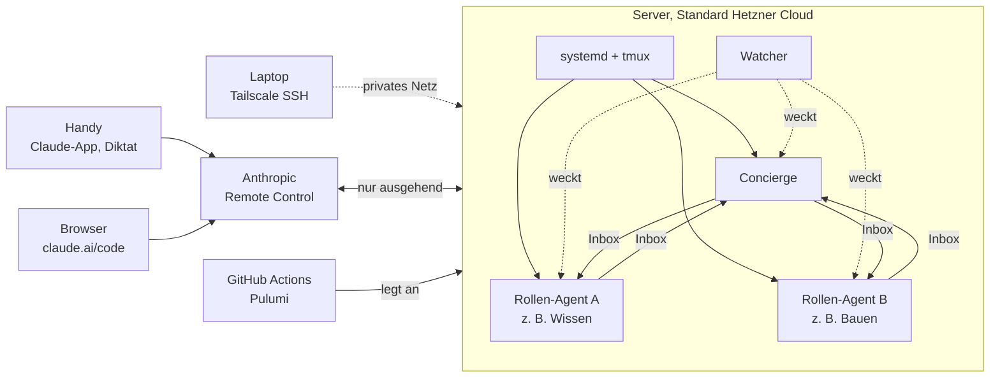

# Meilenstein 1: Bootstrap – Pocket Concierge läuft in der Cloud

Ziel: So schnell wie möglich ein Claude Code, das dauerhaft auf einem eigenen Server läuft und sich vom Handy aus bedienen lässt – auch per Sprache. Der Rundlauf muss nicht perfekt sein. Wichtig ist, dass der Agent ab dann **sich selbst weiterbauen kann**: Web-Kartensimulator, Gateway, Queue und Playdate-Anbindung entstehen in Gesprächen mit genau diesem Agenten.

## Idee

Für den Anfang wird nichts Eigenes gebaut, um an den Agenten heranzukommen. Claude Code bringt dafür **Remote Control** mit: Die Sitzungen laufen auf dem Server, und man steuert sie über [claude.ai/code](https://claude.ai/code) oder die Claude-App auf dem Handy. Remote Control gibt es für Pro- und Max-Abos und braucht keine eingehenden Verbindungen – der Server verbindet sich nur nach außen zu Anthropic.

Auf dem Server laufen mehrere Rollen in eigenen Sitzungen: vorne der **Concierge**, mit dem man spricht, dahinter Rollen-Agenten, die über Inboxen Aufträge bekommen ([`rollen.md`](rollen.md)).

## Wo läuft der Server?

| Option | Kosten (3 Jahre, ca.) | Bemerkung |
| --- | --- | --- |
| **Hetzner Cloud CX23 / CAX11** (Standard) | 255–280 € | Einfache Konsole, stündliche Abrechnung, oft knapp verfügbar |
| Raspberry Pi 5 (8 GB) zu Hause | 270–300 € inkl. Strom | Kein Hosting, dafür Pflege selbst; `host/setup-host.sh` läuft auch dort |
| Azure B2als v2, reserviert | ca. 900 € | Übungsziel für Azure; Anbieter-Funktion in `infra/` noch zu ergänzen |

Alles ab `host/` ist anbieterunabhängig. Nur `infra/` kennt den Anbieter.

## Schritte

Die ausführliche Anleitung mit allen Secrets und Variablen steht in [`infra/README.md`](../infra/README.md).

1. **Konten:** Hetzner Cloud (API-Token), Pulumi Cloud (Token) und Tailscale (Auth-Key). Tailscale auch auf Laptop und Handy installieren.
2. **GitHub-Umgebung `infra`:** Secrets und Variablen eintragen: die drei Tokens, optional die Rollen. Nichts davon landet im Repo.
3. **Server anlegen:** Workflow *Infrastruktur* mit `preview`, dann `up`. Cloud-Init installiert Claude Code, legt die Rollen an und startet die Sitzungen als systemd-Dienste.
4. **Anmelden:** Über Tailscale per `ssh pocket@pocket-concierge` auf den Server, mit `tmux -L pocket-<rolle> attach` in jede Sitzung, dort `/login` und die Rückfrage für Remote Control bestätigen. Kein `ANTHROPIC_API_KEY` setzen, sonst wird über die API abgerechnet.
5. **Rollen einrichten:** Die `CLAUDE.md` jeder Rolle liegt unter `~/roles/<rolle>/` und kommt aus einer Vorlage. Rollen mit eigenem Repo werden aus `POCKET_CONCIERGE_ROLE_REPOS` geklont.
6. **Rest dem Concierge überlassen:** Bau-Rolle, GitHub-Zugang und Gedächtnis richtet er nach [`runbooks/einrichtung-fortsetzen.md`](runbooks/einrichtung-fortsetzen.md) selbst ein; er hält nur an, wenn du etwas in GitHub tun musst.
7. **Vom Handy verbinden:**
   - In der Claude-App die Sitzung **concierge** öffnen; im Alltag nur mit ihr sprechen.
   - Sprechen über die Diktierfunktion von Handy bzw. App.
   - Benachrichtigungen erlauben: Der Agent meldet sich, wenn eine lange Aufgabe fertig ist oder er eine Entscheidung braucht.
   - **Trusted Devices** in den Kontoeinstellungen einschalten, damit nur bestätigte Geräte die Sitzungen steuern dürfen.

## Auf dem Server

| Befehl | Zweck |
| --- | --- |
| `pocket-status` | Rollen, offene und geparkte Aufträge, Quota-Pause |
| `tmux -L pocket-<rolle> attach` | In eine Sitzung schauen (lösen: `Strg+b`, dann `d`) |
| `pocket-inbox --to <rolle> "…"` | Auftrag in eine Inbox legen |
| `sudo pocket-update` | Neuesten Stand dieses Repos holen und Host neu einrichten |
| `journalctl -u pocket-watch -f` | Was der Watcher gerade tut |

## Was damit schon geht

- Ideen und Aufgaben per Sprache vom Handy an den Concierge geben; er verteilt sie an die Rollen.
- Am Repo weiterbauen: als Nächstes der Web-Kartensimulator (Meilenstein 2).
- Mehrere Rollen parallel; bei leerer Quota wird gewartet, nichts geht verloren.

## Bewusste Abkürzungen

| Abkürzung | Später ersetzt durch |
| --- | --- |
| Claude-App statt eigener Geräte | Web-Kartensimulator, dann Playdate, Brille, E-Ink über das Device-Gateway |
| Kein Broker, nur Git-Zugänge mit engem Scope | Rechte- und Tool-Broker |
| Inbox-Dateien und `tmux send-keys` | Eingangs-Queue und Gateway |
| Diktat des Handys statt Intake-Agent | Transkription mit Whisper oder Voxtral |

Die Zielarchitektur ([`arc42.md`](arc42.md)) bleibt unverändert. Remote Control bleibt auch später als Admin- und Notfallzugang erhalten.

## Risiken

- **Shell mit Zugangsdaten:** Bis der Broker steht, liegen Git-Zugänge auf dem Server. Deshalb nur eng eingeschränkte Tokens bzw. Deploy-Keys pro Repo.
- **Sitzungsinhalte bei Anthropic:** Während Remote Control verbunden ist, liegt das Transkript der Sitzung auf den Servern von Anthropic. Keine dienstlichen Daten.
- **Öffentliches Repo:** Workflow-Logs sind öffentlich. Persönliche Werte sind deshalb Secrets und werden auch in Pulumi als geheim markiert.
- **Abo-Limits:** Siehe [`vision.md`](vision.md) und [`rollen.md`](rollen.md), Abschnitt Quota.
