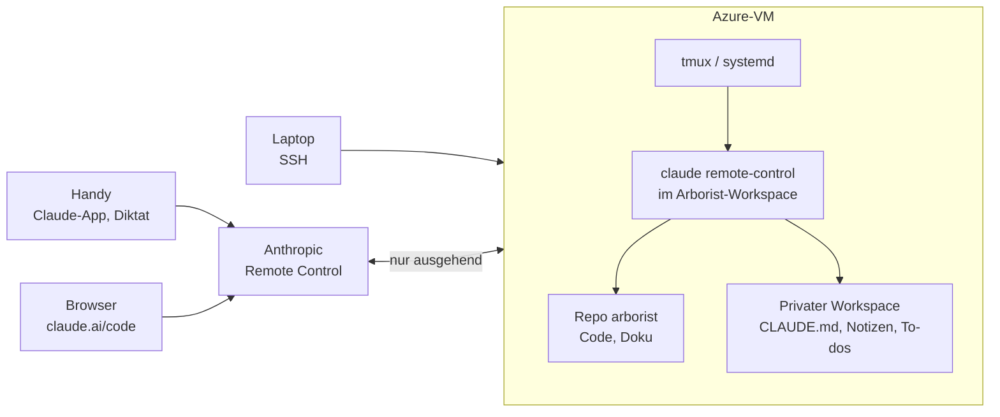

# Meilenstein 1: Bootstrap – Arborist läuft in der Cloud

Ziel: So schnell wie möglich ein Claude Code, das dauerhaft auf einer Azure-VM läuft und sich vom Handy aus bedienen lässt – auch per Sprache. Der Rundlauf muss nicht perfekt sein. Wichtig ist, dass der Agent ab dann **sich selbst weiterbauen kann**: Gateway, Queue, Dashboard und Playdate-Anbindung entstehen in Gesprächen mit genau diesem Agenten.

## Idee

Für den Anfang wird nichts Eigenes gebaut, um an den Agenten heranzukommen. Claude Code bringt dafür **Remote Control** mit: Eine Claude-Code-Sitzung läuft auf der VM, und man steuert sie über [claude.ai/code](https://claude.ai/code) oder die Claude-App auf dem Handy. Remote Control gibt es für Pro- und Max-Abos und braucht keine eingehenden Verbindungen – die VM verbindet sich nur nach außen zu Anthropic.

## Schritte

1. **VM per Pulumi**
   - Linux-VM (z. B. Ubuntu LTS, B2s: 2 vCPU, 4 GB RAM), verwalteter Datenträger für den Workspace.
   - Keine eingehenden Ports außer SSH, und SSH nur von der eigenen IP oder über Azure Bastion bzw. ein privates VPN.
   - Auto-Shutdown aus (der Agent soll laufen), Budget-Alarm an.
   - Cloud-Init: Git, tmux, Python, Node, Docker.
2. **Claude Code installieren** nach der offiziellen Anleitung und einmal per SSH `claude` starten, mit `/login` über claude.ai anmelden. Kein `ANTHROPIC_API_KEY` setzen, sonst wird über die API abgerechnet.
3. **Workspace anlegen**
   - Dieses Repo klonen; GitHub-Zugang mit einem fein eingeschränkten Token nur für die eigenen Projekt-Repos.
   - Daneben einen privaten Workspace mit eigener `CLAUDE.md`: Rolle als Arborist, To-do- und Notizdateien, Hinweis auf die Projekte. Dieser Workspace ist nicht öffentlich.
4. **Remote Control starten**
   - Im Workspace `claude remote-control --name arborist` ausführen und die einmalige Rückfrage bestätigen.
   - Dauerhaft laufen lassen: zunächst in `tmux`, danach als systemd-Dienst, der bei einem Absturz neu startet. Nach einem Neustart holt `claude remote-control` die bisherigen Sitzungen zurück, solange der Stopp nicht länger als etwa vier Stunden her ist.
5. **Vom Handy verbinden**
   - Sitzung in der Claude-App öffnen (QR-Code mit der Leertaste im Server-Terminal anzeigen).
   - Sprechen über die Diktierfunktion von Handy bzw. App.
   - Benachrichtigungen erlauben: Der Agent meldet sich, wenn eine lange Aufgabe fertig ist oder er eine Entscheidung braucht.
   - **Trusted Devices** in den Kontoeinstellungen einschalten, damit nur bestätigte Geräte die Sitzung steuern dürfen.

## Was damit schon geht

- Ideen und Aufgaben per Sprache vom Handy abladen; der Agent pflegt To-do- und Notizdateien im privaten Workspace.
- Am Repo weiterbauen: Gateway, Queue, Web-Dashboard, Playdate-Server.
- Mehrere Sitzungen parallel (Server-Modus), z. B. eine pro Projekt.

## Bewusste Abkürzungen

| Abkürzung | Später ersetzt durch |
| --- | --- |
| Claude-App statt eigener Geräte | Device-Gateway mit Playdate, Web-Dashboard, Brille, E-Ink |
| Kein Broker, nur GitHub-Token mit engem Scope | Rechte- und Tool-Broker |
| Dateien statt Queue | Eingangs-Queue |
| Diktat des Handys statt Intake-Agent | Intake-Agent mit Whisper oder Voxtral |

Die Zielarchitektur ([`arc42.md`](arc42.md)) bleibt unverändert. Remote Control ist der Zugang für den Bau und bleibt auch später als Notfall- und Admin-Zugang erhalten.

## Risiken

- **Shell mit Zugangsdaten:** Bis der Broker steht, liegt das GitHub-Token auf der VM. Deshalb nur ein eng eingeschränktes Token und keine weiteren Zugänge.
- **Sitzungsinhalte bei Anthropic:** Während Remote Control verbunden ist, liegt das Transkript der Sitzung auf den Servern von Anthropic. Keine dienstlichen Daten.
- **Abo-Limits:** Gilt wie im Dauerbetrieb, siehe [`vision.md`](vision.md).
