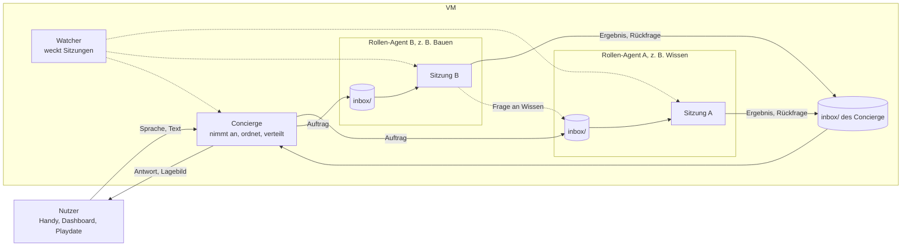

# Rollen und Sitzungen

Arborist läuft nicht als ein einziger Agent, sondern als mehrere **Rollen**, jede in ihrer eigenen Claude-Code-Sitzung. Vorne steht ein **Concierge**, mit dem man spricht. Dahinter arbeiten Rollen-Agenten mit klar getrennten Aufgaben, zum Beispiel einer für Wissen und Notizen und einer für Code-Projekte. Welche Rollen es gibt, wie sie heißen und wie sie sich verhalten, legt jede Instanz selbst fest. Das Repo liefert nur das Muster.

## Warum getrennte Sitzungen

Rollen bleiben nur dann sauber getrennt, wenn sie getrennte Kontexte haben. Springt eine einzige Sitzung zwischen Rollen hin und her, vermischen sich Verhalten und Wissen. Deshalb gilt:

- **Eine Rolle = ein Arbeitsverzeichnis.** Claude Code liest `CLAUDE.md`, Skills und Subagenten aus dem Verzeichnis, in dem es startet. Die Rolle ist damit an ihren Ort gebunden, typischerweise ein eigenes Repo.
- **Eine Rolle = eine dauerhafte Sitzung.** Jede Sitzung behält ihren eigenen Verlauf.
- **Kommunikation nur über Inboxen.** Rollen rufen sich nicht direkt auf, sondern legen sich gegenseitig Aufträge hin.

## Überblick



## Die Rollen

| Rolle | Aufgabe | Arbeitsverzeichnis |
| --- | --- | --- |
| **Concierge** | Einziger Gesprächspartner. Nimmt Sprache und Text an, bereinigt und ordnet, beantwortet Kleinigkeiten selbst, verteilt alles andere an die zuständige Rolle, sammelt Ergebnisse und Rückfragen und meldet sie zurück. Pflegt das Lagebild. | Eigener kleiner Workspace mit Lesezugriff auf die anderen (`--add-dir`) |
| Rollen-Agent | Arbeitet Aufträge aus seiner Inbox ab, in seinem Fachgebiet, mit seinen Skills und Regeln. Meldet Ergebnisse und Rückfragen an den Concierge. | Eigenes Repo bzw. eigener Workspace |

Der Concierge entspricht dem Intake-Agenten aus der Architektur, ergänzt um Verteilung und Rückmeldung. Man kann jede Rolle-Sitzung auch direkt öffnen, etwa für eine längere Arbeitssitzung. Der normale Weg führt aber über den Concierge.

## Der Concierge als Stimme nach außen

Der Concierge ist nicht nur Eingang, sondern auch die einzige Stelle, die Ausgaben für Geräte erzeugt. Er ist so eingestellt, dass er:

- **Cheat-Sheet-Antworten** schreibt: Kernaussage, wenige Zeilen Kontext, auswählbare nächste Schritte. Dieselbe Antwort muss auf Dashboard, Playdate, Brille und E-Ink funktionieren.
- **Pro angemeldetem Gerät** eine passende Ausgabe erzeugt. Er kennt die Fähigkeiten aus der Geräte-Registry und kürzt bzw. formt entsprechend (generische Ansicht, siehe [`arc42.md`](arc42.md), Kapitel 8).
- **Auf Nachfrage eines Geräts** eine aktuelle Zusammenfassung liefert, etwa beim Öffnen der App oder wenn ein E-Ink-Display sein Bild abholt: Was läuft, was ist neu, was wartet auf eine Entscheidung.
- **Rückmeldungen der Rollen** in diese Form übersetzt, bevor sie an Geräte gehen.

Ob er das selbst macht oder an eigene Subagenten abgibt (etwa einen Lagebild-Subagenten oder einen pro Gerätetyp), bleibt offen und wird im Betrieb entschieden.

## Inbox-Protokoll

Jede Rolle hat im eigenen Workspace einen Ordner `inbox/`. Ein Auftrag ist eine Markdown-Datei:

```markdown
---
id: 2026-11-28-1432-ideen-sortieren
from: concierge
to: wissen
created: 2026-11-28T14:32:00+01:00
priority: normal        # normal | dringend
reply_to: concierge
---

Kurze, klare Anweisung. Bezug, Kontext und gewünschtes Ergebnis.
```

Regeln:

- Wer schreibt, legt die Datei erst unter einem temporären Namen an und benennt sie dann um. So sieht der Empfänger nie halbe Dateien.
- Der Empfänger verschiebt erledigte Aufträge nach `inbox/done/`, wartende nach `inbox/parked/`.
- Ergebnisse und Rückfragen gehen als neuer Auftrag an `reply_to`.
- Die Inboxen sind privat und liegen nicht in einem öffentlichen Repo.

Später ersetzt die Eingangs-Queue die Dateien. Das Protokoll bleibt gleich: Absender, Empfänger, Priorität, Status.

## Sitzungen wecken

Eine Claude-Code-Sitzung wartet auf Eingaben und schaut nicht von selbst in ihre Inbox. Ein kleiner **Watcher** übernimmt das: Er bemerkt neue Dateien (z. B. per systemd-Path-Unit oder `inotifywait`) und schickt der zuständigen Sitzung eine kurze Nachricht wie „Neue Aufträge in deiner Inbox, bitte abarbeiten.“ Im Bootstrap geht das mit `tmux send-keys` in das Fenster der Sitzung. Kommt die Nachricht, während die Sitzung noch arbeitet, wird sie danach verarbeitet.

Der Watcher hält sich an die Quota-Regeln: Er weckt nur bei neuen Aufträgen, nie in einer Schleife.

## Dauerbetrieb und Wiederanlauf

Jede Rolle läuft als eigene Sitzung mit Remote Control und taucht dadurch einzeln in der Claude-App auf.

| Ebene | Aufgabe |
| --- | --- |
| systemd | Startet die Sitzungen beim Hochfahren der VM und nach einem Absturz neu, eine Unit pro Rolle |
| tmux | Gibt jeder Sitzung ein Terminal, an das man sich per SSH hängen kann |
| Claude Code | Läuft interaktiv mit Remote Control und setzt den letzten Verlauf fort: `claude --continue --remote-control <rolle>` |

Warum interaktiv mit `--continue` und nicht der Server-Modus `claude remote-control`? Der Server-Modus holt seine Sitzungen nur etwa vier Stunden nach einem Stopp zurück. Eine interaktive Sitzung lässt sich dagegen jederzeit mit `--continue` fortsetzen, auch nach einem längeren Ausfall der VM.

Wichtig: Was eine Rolle wirklich wissen muss, steht in Dateien (Inbox, Notizen, Projektstand), nicht nur im Gesprächsverlauf. Dann schadet auch ein frischer Start nicht.

Einmalig von Hand: `/login` und die Bestätigung für Remote Control in jeder Rolle.

Im Bootstrap zu prüfen: ob sich Remote Control nach `--continue` zuverlässig wieder verbindet. Falls nicht, startet die Unit eine neue Sitzung, und die Rolle liest ihren Stand aus den Dateien.

## tmux oder Herdr?

[Herdr](https://www.thoughtworks.com/radar/tools/herdr) ist ein Terminal-Multiplexer für Coding-Agenten. Er zeigt an, ob eine Sitzung arbeitet, wartet oder blockiert ist, und hat eine CLI, mit der Agenten sich gegenseitig Prompts schicken können. Im ThoughtWorks Tech Radar steht er auf „Assess“, ist also einen Blick wert, aber noch nicht erprobt.

- **Für den Start:** tmux. Stabil, überall vorhanden, und `tmux send-keys` reicht für den Watcher.
- **Später prüfen:** Herdr als bequemere Admin-Ansicht und als Ersatz für `send-keys` beim Wecken.
- **Unabhängig davon:** Den Wiederanlauf nach einem Neustart übernimmt systemd. Weder tmux noch Herdr startet Sitzungen nach einem Reboot von selbst.

## Quota

Alle Rollen teilen sich dieselbe Abo-Quota. Rollen ohne Aufträge verbrauchen nichts. Teuer wird es nur, wenn Rollen sich gegenseitig ohne Not beschäftigen. Deshalb verteilt der Concierge sparsam und bündelt Aufträge.
