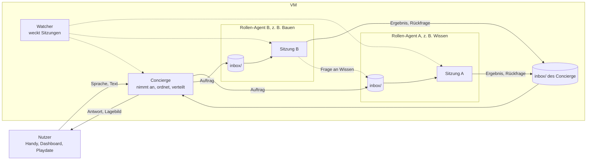

# Rollen und Sitzungen

Pocket Concierge läuft nicht als ein einziger Agent, sondern als mehrere **Rollen**, jede in ihrer eigenen Claude-Code-Sitzung. Vorne steht ein **Concierge**, mit dem man spricht. Dahinter arbeiten Rollen-Agenten mit klar getrennten Aufgaben, zum Beispiel einer für Wissen und Notizen und einer für Code-Projekte. Welche Rollen es gibt, wie sie heißen und wie sie sich verhalten, legt jede Instanz selbst fest. Das Repo liefert nur das Muster.

## Warum getrennte Sitzungen

Rollen bleiben nur dann sauber getrennt, wenn sie getrennte Kontexte haben. Springt eine einzige Sitzung zwischen Rollen hin und her, vermischen sich Verhalten und Wissen. Deshalb gilt:

- **Eine Rolle = ein Arbeitsverzeichnis.** Claude Code liest `CLAUDE.md`, Skills und Subagenten aus dem Verzeichnis, in dem es startet. Die Rolle ist damit an ihren Ort gebunden, typischerweise ein eigenes Repo.
- **Eine Rolle = eine dauerhafte Sitzung.** Jede Sitzung behält ihren eigenen Verlauf.
- **Kommunikation nur über Inboxen.** Rollen rufen sich nicht direkt auf, sondern legen sich gegenseitig Aufträge hin.

## Überblick



## Die Rollen

Rollen haben einen **Typ**, der festlegt, welche Vorlage für ihre `CLAUDE.md` verwendet wird. Den **Namen** einer Rolle wählt jede Instanz selbst; er steht nur auf dem Server, nie im Repo. Die Zuordnung Name → Typ steht in `POCKET_CONCIERGE_ROLE_TYPES`, z. B. `meinbauer=bauen notizen=wissen`.

| Typ | Aufgabe | Arbeitsverzeichnis | Zugänge | Vorlage |
| --- | --- | --- | --- | --- |
| **Concierge** (fest, Name `concierge`) | Einziger Pflicht-Gesprächspartner. Nimmt Sprache und Text an, bereinigt und ordnet, beantwortet Kleinigkeiten selbst, verteilt alles andere, sammelt Ergebnisse und Rückfragen, pflegt das Lagebild, erzeugt Cheat-Sheet-Ausgaben für Geräte. | `~/roles/concierge` | keine externen | [`templates/concierge`](../host/templates/concierge/CLAUDE.md) |
| **Bauen** | Baut und pflegt Software-Projekte in Git-Repos: Funktionen, Fehler, Doku, Pull Requests. Mehrere Repos gleichzeitig, eins pro Unterordner, mit einer Projektliste `projekte.md`. Baut auch Pocket Concierge selbst weiter. | `~/roles/<name>/<repo>` je Projekt | `git` und `gh` mit fine-grained PAT, nur für freigegebene Repos | [`templates/bauen`](../host/templates/bauen/CLAUDE.md) |
| **Wissen** | Verwaltet Notizen und Wissen: aufnehmen, einordnen, verknüpfen, verdichten, wiederfinden. Typischerweise ein eigenes Notiz-Repo mit eigenen Skills. | `~/roles/<name>`, oft selbst ein Repo (über `POCKET_CONCIERGE_ROLE_REPOS`) | Git-Zugang zum Notiz-Repo | [`templates/wissen`](../host/templates/wissen/CLAUDE.md) |
| Allgemein | Jede andere Rolle; Zuständigkeit beschreibt man selbst. | `~/roles/<name>` | je nach Bedarf | [`templates/role`](../host/templates/role/CLAUDE.md) |

**Eine oder mehrere Bau-Rollen?** Eine Bau-Rolle reicht für viele Repos; sie arbeitet ein Gespräch nach dem anderen ab und kann für Teilaufgaben selbst Subagenten starten. Eine zweite Bau-Rolle lohnt sich erst, wenn zwei große Projekte wirklich gleichzeitig laufen sollen und ihre Kontexte getrennt bleiben müssen. Alle Rollen teilen sich dieselbe Quota.

**Direkt oder über den Concierge?** Beides ist vorgesehen:

- **Direkt**, wenn man gezielt arbeitet, etwa an einem Projekt mit der Bau-Rolle. Man öffnet deren Sitzung in der Claude-App oder unter claude.ai/code. Kein Umweg, weniger Quota.
- **Über den Concierge**, wenn man unterwegs etwas ablegt oder den Überblick will. Er verteilt per Inbox; die Rolle arbeitet es ab, wenn sie dran ist.

Der Concierge entspricht dem Intake-Agenten aus der Architektur, ergänzt um Verteilung und Rückmeldung.

### Zugang der Bau-Rolle zu GitHub

- Ein **fine-grained Personal Access Token** (PAT), beschränkt auf ausgewählte Repos, mit den Rechten *Contents*, *Pull requests* und *Issues* (Lesen und Schreiben) sowie *Metadata* (Lesen), mit Ablaufdatum.
- Auf dem Server mit `gh auth login --with-token` angemeldet; `gh auth setup-git` lässt auch `git` das Token nutzen.
- **Kommt ein Repo dazu, muss das PAT erweitert werden:** In GitHub beim Token unter *Repository access* das Repo hinzufügen. Auf dem Server ändert sich nichts, solange das Token dasselbe bleibt. Wird es neu erzeugt (etwa nach Ablauf), erneut `gh auth login` ausführen.
- Später übernimmt der Rechte- und Tool-Broker das Token; dann liegt es nicht mehr auf dem Server.

## Der Concierge als Stimme nach außen

Der Concierge ist nicht nur Eingang, sondern auch die einzige Stelle, die Ausgaben für Geräte erzeugt. Er ist so eingestellt, dass er:

- **Cheat-Sheet-Antworten** schreibt: Kernaussage, wenige Zeilen Kontext, auswählbare nächste Schritte. Dieselbe Antwort muss auf Dashboard, Playdate, Brille und E-Ink funktionieren.
- **Pro angemeldetem Gerät** eine passende Ausgabe erzeugt. Er kennt die Fähigkeiten aus der Geräte-Registry und kürzt bzw. formt entsprechend (generische Ansicht, siehe [`arc42.md`](arc42.md), Kapitel 8).
- **Auf Nachfrage eines Geräts** eine aktuelle Zusammenfassung liefert, etwa beim Öffnen der App oder wenn ein E-Ink-Display sein Bild abholt: Was läuft, was ist neu, was wartet auf eine Entscheidung.
- **Rückmeldungen der Rollen** in diese Form übersetzt, bevor sie an Geräte gehen.

Ob er das selbst macht oder an eigene Subagenten abgibt (etwa einen Lagebild-Subagenten oder einen pro Gerätetyp), bleibt offen und wird im Betrieb entschieden.

## Inbox-Protokoll

Jede Rolle hat im eigenen Workspace einen Ordner `inbox/`. Ein Auftrag ist eine Markdown-Datei:

```markdown
---
id: 2026-11-28-1432-ideen-sortieren
from: concierge
to: wissen
created: 2026-11-28T14:32:00+01:00
priority: normal        # normal | dringend
reply_to: concierge
---

Kurze, klare Anweisung. Bezug, Kontext und gewünschtes Ergebnis.
```

Regeln:

- Wer schreibt, legt die Datei erst unter einem temporären Namen an und benennt sie dann um. So sieht der Empfänger nie halbe Dateien.
- Der Empfänger verschiebt erledigte Aufträge nach `inbox/done/`, wartende nach `inbox/parked/`.
- Ergebnisse und Rückfragen gehen als neuer Auftrag an `reply_to`.
- Die Inboxen sind privat und liegen nicht in einem öffentlichen Repo.

Später ersetzt die Eingangs-Queue die Dateien. Das Protokoll bleibt gleich: Absender, Empfänger, Priorität, Status.

## Sitzungen wecken

Eine Claude-Code-Sitzung wartet auf Eingaben und schaut nicht von selbst in ihre Inbox. Ein kleiner **Watcher** übernimmt das: Er bemerkt neue Dateien (z. B. per systemd-Path-Unit oder `inotifywait`) und schickt der zuständigen Sitzung eine kurze Nachricht wie „Neue Aufträge in deiner Inbox, bitte abarbeiten.“ Im Bootstrap geht das mit `tmux send-keys` in das Fenster der Sitzung. Kommt die Nachricht, während die Sitzung noch arbeitet, wird sie danach verarbeitet.

Der Watcher hält sich an die Quota-Regeln: Er weckt nur bei neuen Aufträgen, nie in einer Schleife.

## Dauerbetrieb und Wiederanlauf

Jede Rolle läuft als eigene Sitzung mit Remote Control und taucht dadurch einzeln in der Claude-App auf.

| Ebene | Aufgabe |
| --- | --- |
| systemd | Startet die Sitzungen beim Hochfahren der VM und nach einem Absturz neu, eine Unit pro Rolle |
| tmux | Gibt jeder Sitzung ein Terminal, an das man sich per SSH hängen kann |
| Claude Code | Läuft interaktiv mit Remote Control und setzt den letzten Verlauf fort: `claude --continue --remote-control <rolle>` |

Warum interaktiv mit `--continue` und nicht der Server-Modus `claude remote-control`? Der Server-Modus holt seine Sitzungen nur etwa vier Stunden nach einem Stopp zurück. Eine interaktive Sitzung lässt sich dagegen jederzeit mit `--continue` fortsetzen, auch nach einem längeren Ausfall der VM.

Wichtig: Was eine Rolle wirklich wissen muss, steht in Dateien (Inbox, Notizen, Projektstand), nicht nur im Gesprächsverlauf. Dann schadet auch ein frischer Start nicht.

Einmalig von Hand: `/login` und die Bestätigung für Remote Control in jeder Rolle.

Im Bootstrap zu prüfen: ob sich Remote Control nach `--continue` zuverlässig wieder verbindet. Falls nicht, startet die Unit eine neue Sitzung, und die Rolle liest ihren Stand aus den Dateien.

## tmux oder Herdr?

[Herdr](https://www.thoughtworks.com/radar/tools/herdr) ist ein Terminal-Multiplexer für Coding-Agenten. Er zeigt an, ob eine Sitzung arbeitet, wartet oder blockiert ist, und hat eine CLI, mit der Agenten sich gegenseitig Prompts schicken können. Im ThoughtWorks Tech Radar steht er auf „Assess“, ist also einen Blick wert, aber noch nicht erprobt.

- **Für den Start:** tmux. Stabil, überall vorhanden, und `tmux send-keys` reicht für den Watcher.
- **Später prüfen:** Herdr als bequemere Admin-Ansicht und als Ersatz für `send-keys` beim Wecken.
- **Unabhängig davon:** Den Wiederanlauf nach einem Neustart übernimmt systemd. Weder tmux noch Herdr startet Sitzungen nach einem Reboot von selbst.

## Quota

Alle Rollen teilen sich dieselbe Abo-Quota. Das System ist darauf ausgelegt, mit einem Pro-Abo auszukommen: Es arbeitet die Inboxen ab, solange Quota da ist, und wartet sonst.

**Wenn die Quota leer ist:**

1. Eingaben werden weiter angenommen und landen in den Inboxen. Der Concierge bestätigt „abgelegt, wird nach dem Reset bearbeitet“, sobald er selbst wieder arbeiten kann; bis dahin quittiert später das Gateway.
2. Der Watcher erkennt das Limit an der Meldung von Claude Code im Terminal der Sitzung (`tmux capture-pane`) und merkt sich die angezeigte Reset-Zeit.
3. Bis dahin weckt er keine Sitzung mehr. Es entstehen keine Fehlversuche, die nur Zeit kosten.
4. Nach dem Reset weckt er die Rollen nacheinander, dringende Aufträge zuerst.

Weil alles in Inbox-Dateien steht, geht beim Warten nichts verloren. Rollen ohne Aufträge verbrauchen nichts. Teuer wird es nur, wenn Rollen sich gegenseitig ohne Not beschäftigen. Deshalb verteilt der Concierge sparsam und bündelt Aufträge.
