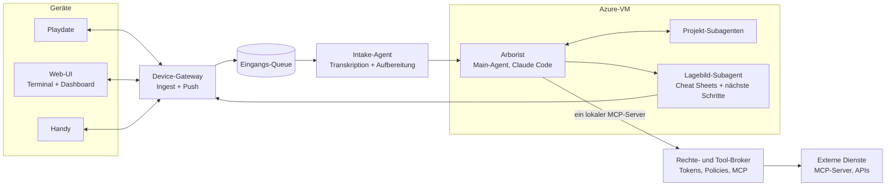

# Vision und Scope: Arborist

> Ergänzt [`arc42.md`](arc42.md). arc42 beschreibt den Playdate-POC, dieses Dokument das Zielbild und den Projektumfang.

## 1. Ziel

**Arborist** ist ein persönlicher Assistent, der rund um die Uhr läuft: Claude Code CLI mit einem Claude-Abo, dauerhaft auf einer Azure-VM. Er nimmt persönliche Belange entgegen – To-dos, Projekte, Notizen, Recherchen – und kümmert sich selbstständig darum, mehrere Projekte parallel am Laufen zu halten.

- **Ideen abladen, später abarbeiten:** Eingaben werden sofort und sicher gespeichert. Wann der Agent sie bearbeitet, ist zweitrangig. Er arbeitet asynchron, in Schleifen und in Batches.
- **Immer erreichbar:** Der Eingang ist 24/7 offen. Der Agent arbeitet im Rahmen der Abo-Quota; ist sie aufgebraucht, wartet er bis zum wöchentlichen Reset.
- **Sprache zuerst:** Sprache ist das Hauptmedium. Jede Interaktion geht aber auch ohne Sprache, über vorbereitete Antworten und Themen.
- **Viele Geräte:** Registrierte Endgeräte greifen auf denselben Agenten zu.
- **Kontrollierte Werkzeuge:** Der Agent bekommt externe Tools nur über einen Rechte- und Tool-Broker, nie direkt.

## 2. Überblick

## 3. Bausteine

### 3.1 Endgeräte

Jedes Gerät wird registriert (Gerätetoken) und meldet seine Fähigkeiten: Eingabe (Sprache, Text, Auswahl) und Ausgabe (Karten, HTML, Terminal).

| Gerät | Eingabe | Ausgabe |
| --- | --- | --- |
| Playdate | Sprache (offline gepuffert), Auswahl per Kurbel und Tasten | 1-Bit-Karten nach [Karten-DSL](karten-dsl.md) |
| Web-UI | Sprache, Text, Terminal | Dashboard mit Lagebild und Projekten; Terminal (z. B. xterm.js) auf die Agent-Session |
| Handy | Sprache, Text, Auswahl | Web-UI mobil, Benachrichtigungen |
| Später | z. B. E-Ink-Display | passive Anzeige über Adapter |

### 3.2 Device-Gateway (Ingest und Push)

Einziger Eingang für Geräte.

- **Ingest:** Audio (chunked, idempotent, wiederaufnehmbar), Text und Auswahl-Interaktionen.
- **Push:** Verteilt Ausgaben an alle passenden Geräte. Geräte mit dauerhafter Verbindung (Web, Handy) bekommen sie per WebSocket bzw. Web-Push; der Playdate holt sie per Pull mit `since`-Cursor ab, weil er keinen Push-Kanal hat.
- **Adapter:** Übersetzen ein generisches Ausgabeformat in Karte, HTML oder Text.
- **Registry:** Geräte, Tokens, Fähigkeiten, zuletzt gesehen.

### 3.3 Eingangs-Queue

Das Herz des asynchronen Ablaufs. Alles, was ankommt, landet hier – dauerhaft gespeichert, bevor irgendein Modell beteiligt ist.

- **Sicher ablegen:** Eine Eingabe gilt als angenommen, sobald sie in der Queue steht. Das Gerät bekommt sofort eine Quittung („abgelegt“), unabhängig davon, ob der Agent gerade läuft oder die Quota leer ist.
- **Zustände:** `received → transcribed → prepared → queued → in_progress → done/parked`. Geparkt wird, was auf Rückfrage, Bestätigung oder den Quota-Reset wartet.
- **Batchweise abarbeiten:** Der Arborist holt sich mehrere Einträge auf einmal, gruppiert sie nach Projekt und Thema und arbeitet sie zusammen ab. Das spart Kontext und Quota.
- **Wiederholbar:** Einträge bleiben nach der Bearbeitung erhalten (Verlauf fürs Dashboard und die Nachtwartung).
- **Priorität:** Der Intake-Agent markiert Dringendes; dringende Einträge werden vor dem nächsten Batch gezogen.

**Technikwahl (offen):**

| Option | Passt, weil | Dagegen |
| --- | --- | --- |
| SQLite (wie im POC) | Null Betrieb, reicht für eine Person, Zustände und Verlauf in einer Tabelle | Nur ein Schreiber, kein Fan-out |
| Redis Streams oder NATS JetStream | Leichtgewichtig, Consumer-Gruppen, Replays, Batch-Abholung | Ein Dienst mehr |
| Azure Service Bus / Storage Queue | Verwaltet, überlebt VM-Ausfälle | Kosten, Cloud-Abhängigkeit, kein Verlauf |
| Kafka | Starke Log-Semantik, Replays | Für einen Nutzer und wenige Nachrichten pro Tag deutlich überdimensioniert |

Empfehlung zum Start: SQLite mit sauberem Zustandsmodell hinter einer kleinen Queue-Schnittstelle. Wird Fan-out oder Entkopplung über Container wichtig, auf NATS JetStream oder Redis Streams wechseln. Kafka nur, wenn das Volumen es wirklich verlangt.

### 3.4 Intake-Agent

Steht vor dem Arborist und macht aus Rohdaten eine saubere Anweisung.

- Transkribiert Sprache über einen austauschbaren Provider: lokal (Whisper) oder Voxtral-API.
- Bereinigt Füllwörter, erkennt Sprache, Bezug auf laufende Themen und Dringlichkeit.
- Schreibt das Ergebnis als vorbereiteten Auftrag zurück in die Eingangs-Queue.
- Darf ein kleines, günstiges Modell nutzen. Er hat keine Tools außer der Queue.

### 3.5 Arborist (Main-Agent)

Claude Code CLI, dauerhaft laufend, mit fortgesetzter Session.

- Arbeitet in Schleifen: holt einen Batch aus der Eingangs-Queue, ordnet die Einträge Projekten zu, bearbeitet sie und holt den nächsten Batch, bis die Queue leer ist.
- Delegiert an **Projekt-Subagenten**, je einer pro Projekt bzw. Bereich (z. B. To-dos, ein Code-Projekt, Recherche). Mehrere Projekte laufen parallel.
- Hält den Überblick: offene Aufgaben, laufende Subagenten, Wiedervorlagen. Stößt periodisch selbst Arbeit an.
- Arbeitet in sich abgeschlossen in seinem Container. Externe Dienste erreicht er nur über den Broker.

### 3.6 Lagebild-Subagent

Läuft immer mit und macht den Agenten auch ohne Sprache bedienbar.

- Schreibt zu jeder laufenden Tätigkeit eine kurze, Cheat-Sheet-artige Zusammenfassung.
- Bietet **mögliche nächste Schritte** als vorgefertigte Antworten an.
- Pflegt eine Liste der **aktuellen Themen des Tages**, die man auf einem Handheld auswählen kann.
- Gibt alles im generischen Ausgabeformat ans Gateway, das es pro Gerät rendert.

### 3.7 Rechte- und Tool-Broker

Der Agent bekommt **keine eigenen Tool-Anbindungen**. Alles Externe läuft über den Broker.

- **Anmeldung:** Externe MCP-Server und APIs werden im Broker eingerichtet; der Nutzer meldet sich dort an. Der Broker hält alle Tokens. Der Agent sieht nie ein Token.
- **Ein MCP-Server für den Agenten:** Der Broker stellt dem Arborist genau einen lokalen MCP-Server bereit. Darin stehen nur die Tools, die gerade erlaubt sind.
- **Granulare Rechte:** Pro Tool (und pro Subagent bzw. Projekt) einstellbar: erlaubt, verboten oder nur nach Bestätigung. Bestätigungen laufen als Auswahl-Karte über das Gateway aufs Gerät.
- **Protokoll:** Jeder Tool-Aufruf wird mitgeschrieben und ist im Dashboard sichtbar.
- **Trennung:** Der Broker läuft in einem eigenen Container. Der Agent-Container enthält keine Zugangsdaten.

Grenze: Die eingebauten Werkzeuge von Claude Code (Shell, Dateien) arbeiten im Agent-Container und laufen nicht über den Broker. Sie werden über die Claude-Code-Einstellungen eingeschränkt; Netzwerkzugriff aus dem Container nur zum Broker und zu Anthropic.

## 4. Betrieb

- **Plattform:** Azure-VM (z. B. B2s: 2 vCPU, 4 GB RAM) mit Docker; Container für Gateway, Intake, Arborist und Broker.
- **IaC:** Pulumi provisioniert VM, Netzwerk, Firewall (nur 443), Speicher und Secrets.
- **Zugriff:** HTTPS über Reverse Proxy; Gerätetoken pro Gerät.
- **Mehrere Instanzen:** Der Stack ist parametrisierbar, damit sich getrennte Instanzen betreiben lassen. Eine Arbeits-Instanz nur mit Freigabe des Arbeitgebers.

## 5. Betriebsmodi und Nutzungslimits

Claude Code mit Abo darf auf der eigenen VM laufen, solange man sich selbst über den offiziellen Anmeldeweg einloggt und das unveränderte Claude Code nutzt. Die Limits des Abos (Fünf-Stunden-Fenster und Wochenlimit) sind aber auf gewöhnliche, individuelle Nutzung ausgelegt. Ein Dauerbetrieb mit ständigen Aufrufen ist damit nicht gewährleistet – und muss es auch nicht sein. Arborist bleibt bewusst im Rahmen der Quota und ist **ereignisgesteuert**:

| Modus | Wann | Verhalten |
| --- | --- | --- |
| Aktiv | Queue enthält Einträge | Arbeitet Batches ab, Subagenten arbeiten, Lagebild wird aktualisiert |
| Leerlauf | Keine Aufträge | Keine Modellaufrufe. Gateway, Broker und Queue laufen weiter und nehmen Eingaben an |
| Nachtwartung | Einmal nachts, zeitgesteuert | Sichtet die Aufgaben des Tages, schreibt Zusammenfassungen und Wiedervorlagen, pflegt das eigene Gedächtnis (Projektdateien, gelernte Vorlieben), plant den nächsten Tag; danach Leerlauf |
| Quota leer | Kontingent aufgebraucht | Agent pausiert. Eingang und Queue laufen weiter, Geräte bekommen „abgelegt“. Nach dem Reset wird die Queue abgearbeitet. Kein Überlauf auf API-Abrechnung |

Regeln:

- Kein Polling durch das Modell. Zeitgesteuerte Arbeit (Nachtwartung, Wiedervorlagen) startet ein Scheduler außerhalb des Agenten.
- Die Nachtwartung hat ein festes Budget, weil sie auf dasselbe Wochenlimit zählt.
- Ein API-Key wird nie als Umgebungsvariable im Agent-Container gesetzt, solange das Abo genutzt werden soll; Claude Code würde ihn sonst bevorzugen.
- Der Broker verwaltet nur Tokens externer Dienste, nie die Claude-Anmeldung.

## 6. Scope

**Drin:**

- Arborist als 24/7-Main-Agent mit Projekt-Subagenten und Lagebild-Subagent
- Intake-Agent mit Sprach-Transkription
- Device-Gateway mit Registry, Ingest und Push
- Clients: Playdate, Web-UI (Dashboard und Terminal), Handy (über Web-UI)
- Rechte- und Tool-Broker mit einem MCP-Server für den Agenten
- Betrieb auf Azure-VM, provisioniert mit Pulumi

**Nicht drin (vorerst):**

- Sprachausgabe
- Mehrbenutzerbetrieb (eine Instanz gehört genau einer Person)
- Eigene native Handy-App
- Weitere Geräte wie E-Ink (später über Adapter)

## 7. Ausbaustufen

1. **POC lokal:** Playdate → Ingest → Transkription → einfacher Agent → Karten (siehe [`poc-setup.md`](poc-setup.md)).
2. **VM-Basis:** Pulumi-Stack, Docker, Arborist läuft 24/7, Web-Terminal, Scheduler mit Nachtwartung.
3. **Eingangs-Queue, Gateway und Lagebild:** Asynchroner Eingang mit Quittung und Batch-Abarbeitung, Registry, Push, Dashboard, Lagebild-Subagent mit Auswahl-Antworten.
4. **Broker:** Erster Tool-Zugang (z. B. To-do-Dienst) ausschließlich über den Broker, Bestätigungen per Karte.
5. **Projekt-Subagenten:** Parallele Projekte, Wiedervorlagen, periodische Selbststeuerung.

## 8. Offene Fragen

- **Abo im Dauerbetrieb:** Stand November 2026 zählen auch Headless-Aufrufe (`claude -p`) und das Agent SDK auf die Abo-Limits; eine angekündigte Trennung wurde im Juni 2026 pausiert. Bedingungen regelmäßig prüfen, weil sich das ändern kann.
- **Broker:** Selbst bauen oder ein bestehendes MCP-Gateway als Basis nehmen?
- **Queue-Technik:** SQLite zum Start, später NATS JetStream oder Redis Streams? Kafka nur bei echtem Bedarf (siehe 3.3).
- **Batch-Größe und Takt:** Wie viele Einträge pro Batch, und wie schnell nach einer neuen Eingabe startet die Bearbeitung?
- **Intake-Modell:** Welches Modell bereitet die Anweisungen auf, und läuft es lokal oder per API?
- **Persistenz des Agenten:** Wie übersteht der Kontext Neustarts und lange Laufzeiten (Session-Wechsel, Zusammenfassungen, Projektdateien)?
